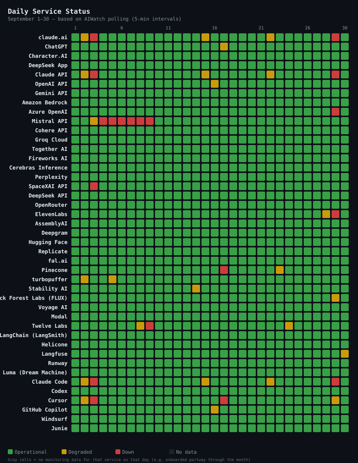
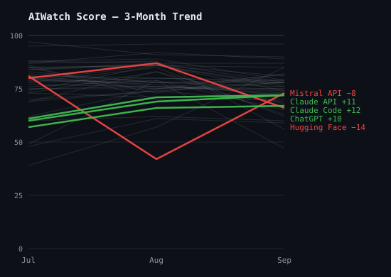
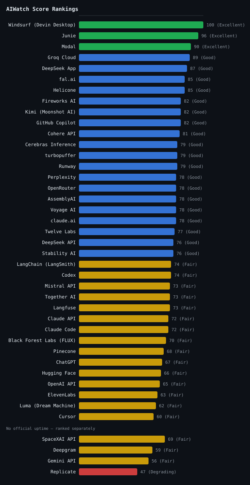

> **Source**: [ai-watch.dev](https://ai-watch.dev) — Real-time AI service status monitoring
> **Period**: September 1–30, 2026
> **Published**: October 2026
> **Services monitored**: 46 — 16 LLM APIs, 8 inference & infra, 6 coding agents, 5 AI apps, 4 voice & transcription, 3 observability, 2 video, 2 image

<!-- AUTHORING SELF-CHECK — read before writing prose; these are the recurring misses:
     1. CLAIMS BACKED BY DATA, AT THE RIGHT SCOPE. Every superlative/absolute ("the slowest", "the most",
        "worst month", "the only", "never") must be TRUE over the scope you state. Qualify to what the
        measurement supports: p75 is an edge-RTT probe to ONE endpoint, not "the slowest SERVICE"; a
        "worst month" must hold on the metric you mean (Score? downtime?) and beat EVERY peer — check the
        data, a lower-scoring sibling breaks "worst coding agent". Prefer "highest edge-probe RTT among
        probed services" / "most downtime of any coding agent" to a bare superlative. Soften unprovable
        absolutes ("never" -> "rarely").
     2. ONE HOME PER FACT — don't over-emphasise. A specific figure/superlative (e.g. one service's p75)
        belongs in ONE analytical home (its Notable Incident, or the data table), not restated across
        Summary + Notable Incidents + Observations. Weight a factor by its real contribution, not by how
        many times you can repeat it.
     3. ADVISORY != OUTAGE. Before calling something an outage, read the incident TITLE + impact, not just
        its duration. A usage-limits / billing / model-access / policy notice (often impact:minor) is an
        ADVISORY, not downtime — label it so (as the Anthropic entries do). If the archive counted such a
        notice as downtime it inflates the Score drop (a worker-side classification bug, cf. aiwatch#707);
        flag it. A long duration alone does not make an availability incident. -->

## Summary

> Every score in this report is the **AIWatch Score** (0–100): one number combining uptime, incident load, recovery speed and responsiveness. Higher is better. [How it's built →](#aiwatch-score--september-2026-reliability-rankings)

- **Most reliable**: Windsurf (Devin Desktop) at 100 for a fourth straight month; Junie (96) and Modal (90) are the only other Excellent grades.
- **Biggest drop**: Luma (Dream Machine), Good 85 → Fair 62 in the main ranking. Most of the fall is recovery time: August had no incidents, while September's three Ray2 events, all filed at minor impact, averaged 8h to resolve — see [Incident Summary](#incident-summary).
- **Status source changes**: The status page AIWatch reads changed for five services: four providers moved their pages, and Windsurf, renamed Devin Desktop, is now read from the Devin status page. Replicate's new page publishes no uptime, so it now ranks in the separate No Official Uptime table — see [Status source changes](#status-source-changes).
- **Watch out**: Mistral API rose from Degrading 42 to Fair 73, the largest rise of any ranked service, and its downtime fell from 138h 3m to 24h 49m. The two downtime figures are not counted the same way: from September, time when several incidents were open at once is counted once — see [How AIWatch Works → Incident counting](https://ai-watch.dev/methodology#incidents).

<strong>Summary in Korean</strong>

<ul>
<li><strong>가장 안정적</strong>: Windsurf (Devin Desktop)가 넉 달 연속 100점입니다. 이 밖에 Excellent 등급은 Junie(96점)와 Modal(90점)뿐입니다.</li>
<li><strong>가장 크게 하락</strong>: 메인 순위표 기준으로 Luma (Dream Machine)가 Good 85점에서 Fair 62점으로 떨어졌습니다. 하락폭 대부분은 복구 시간 때문입니다. 8월에는 장애가 없었는데, 9월에는 Ray2 장애 세 건(모두 minor)이 해결되기까지 평균 8시간이 걸렸습니다(<a href="#incident-summary">Incident Summary</a> 참고).</li>
<li><strong>상태 출처 변경</strong>: 9월에 AIWatch가 읽는 상태 페이지가 바뀐 서비스는 다섯 곳입니다. 네 곳은 업체가 상태 페이지를 옮겼고, Windsurf는 Devin Desktop으로 이름이 바뀌면서 Devin 상태 페이지 기준으로 집계합니다. Replicate는 새 상태 페이지가 업타임을 공개하지 않아 별도의 No Official Uptime 표로 옮겼습니다(<a href="#status-source-changes">Status source changes</a> 참고).</li>
<li><strong>주의 필요</strong>: Mistral API는 Degrading 42점에서 Fair 73점으로 올라 상승 폭이 가장 컸고, 다운타임도 138시간 3분에서 24시간 49분으로 줄었습니다. 다만 두 다운타임은 같은 방식으로 센 값이 아닙니다. 9월부터는 여러 장애가 동시에 진행된 시간을 한 번만 셉니다(<a href="https://ai-watch.dev/methodology#incidents">How AIWatch Works → Incident counting</a> 참고).</li>
</ul>

---

## Recommendations

<table class="recommendations">
<thead>
<tr><th>Use Case</th><th>Recommended</th><th>Why</th></tr>
</thead>
<tbody>
<tr><td><strong>Production-critical</strong></td><td>Groq Cloud</td><td>89 on 100.00% uptime with no incidents at all; every point it gives up is on Responsiveness (251 ms p50, CV 0.51). Modal is the alternative at 90</td></tr>
<tr><td><strong>Low latency / cost</strong></td><td>Cohere API</td><td>81, the lowest p50 (227 ms) of any service graded Good or better, with one 4h 23m incident</td></tr>
<tr><td><strong>General purpose</strong></td><td>Mistral API</td><td>73 on 99.45% uptime. None of the OpenAI, Anthropic, Google or Mistral APIs reached Good this month — Claude API is a point behind at 72, OpenAI API is at 65, and Gemini API publishes no uptime and is ranked separately at 56</td></tr>
<tr><td><strong>Coding Agents</strong></td><td>Windsurf (Devin Desktop)</td><td>100 — one 1m incident and 100.00% uptime, the top Score in the report for a fourth straight month. Junie is next at 96</td></tr>
<tr><td><strong>Inference / infra</strong></td><td>Modal</td><td>90 — eight incidents, 5h 53m in total, longest 2h 8m. fal.ai is the Official-source alternative at 85 with no incidents</td></tr>
<tr><td><strong>Voice / audio</strong></td><td>AssemblyAI</td><td>78 on 99.96% uptime, three incidents totalling 1h 46m. ElevenLabs fell to 63; Deepgram publishes no official uptime and is ranked separately at 59</td></tr>
<tr><td><strong>Observability</strong></td><td>Helicone</td><td>85 with no incidents and 99.99% uptime (Platform-sourced), up from 57 in August. LangSmith (74) and Langfuse (73) follow</td></tr>
<tr><td><strong>Video</strong></td><td>Runway</td><td>79 — one 2h 22m incident and 100.00% uptime. Luma (Dream Machine), last month's pick, fell to 62</td></tr>
<tr><td><strong>Image</strong></td><td>Stability AI</td><td>76 — one 4h 8m incident and 99.94% uptime. Black Forest Labs (FLUX) holds at 70</td></tr>
</tbody>
</table>

---

## Key Insight

September's middle tier slid: in the main ranking table Good fell from 23 services to 19 and Fair rose from 10 to 15. 40 of 46 services recorded at least one incident, for a combined 815h 29m of downtime.

- **Pattern 1 — all 49 of Together AI's September incidents are reconstructed from its status page's daily availability record.** None is an incident the provider posted, so the month is not comparable with August, when 24 of 64 were reconstructed. This is the first month its record rests entirely on reconstruction. Its Score barely moved, 71 → 73.
- **Pattern 2 — AIWatch's probes caught degradations the status pages weren't showing at the time.** Direct RTT probes flagged 230 RTT degradations this month, 208 of them not reflected on the providers' own status pages at the time of detection. Gemini API logged 64 flagged, 49 of them not on its status page, in a month that page carried a single incident. Deepgram led the count at 94, 93 of them not on its status page. Per-service breakdown in [RTT Degradation Detection](#rtt-degradation-detection).

<strong>Key Insight in Korean</strong>

9월에는 Good 등급이 줄고 Fair 등급이 늘었습니다. 메인 순위표에서 Good은 23곳에서 19곳으로, Fair는 10곳에서 15곳으로 바뀌었습니다. 46곳 중 40곳에서 장애가 1건 이상 있었고, 다운타임은 모두 합쳐 815시간 29분입니다.

<ul>
<li><strong>패턴 1 — Together AI의 9월 장애 기록 49건은 모두 상태 페이지의 일별 가용성 데이터에서 재구성한 것입니다.</strong> 업체가 올린 장애 공지가 아니어서 8월(64건 중 24건 재구성)과 같은 기준으로 비교할 수 없습니다. Together AI의 장애 기록이 모두 재구성한 기록으로만 채워진 달은 이번이 처음입니다. 점수는 71점에서 73점으로 거의 변하지 않았습니다.</li>
<li><strong>패턴 2 — 상태 페이지에 나타나지 않았던 성능 저하를 AIWatch 프로브가 잡아냈습니다.</strong> 이달 AIWatch가 RTT를 직접 측정해 감지한 성능 저하는 230건이며, 그중 208건은 감지 당시 해당 업체의 상태 페이지에 표시되지 않았습니다. Gemini API의 상태 페이지에는 이달 장애가 단 1건만 올라왔지만, 프로브는 성능 저하 64건을 감지했고 그중 49건은 상태 페이지에 없었습니다. 감지 건수는 Deepgram이 94건으로 가장 많았고, 그중 93건이 상태 페이지에 없었습니다. 서비스별 내역은 <a href="#rtt-degradation-detection">RTT Degradation Detection</a> 섹션에서 확인할 수 있습니다.</li></ul>

---

## 3-Month Trend

AIWatch Score direction over the last 3 months (2026-07 → 2026-09). The lines plot each service's composite Score. **Notable Movers** below are NOT ranked by these lines — a service earns its place, and its order, by the largest change on *any* of three axes (Score, recovery time, or total downtime), which is why one with a small Score move can top the list on a downtime swing the chart cannot show.

### Notable Movers

*The 5 services whose **Score, recovery time (MTTR), or total downtime** changed most over the window (ranked by the largest single change, not a fixed threshold). The metric in **bold** is the change that ranked each service here; 🔺 / 🔻 mark whether that headline metric improved or worsened — so a service can show a small Score gain yet land here, and read 🔻, because its downtime regressed.*

- 🔻 **Hugging Face** — Score 80 → 87 → 66 (−14) · **MTTR 43m → 4h 3m → 71h 54m (+71h 11m)** · downtime 2h 50m → 8h 6m → 149h 6m (+146h 16m)
- 🔺 **Claude API** — Score 61 → 71 → 72 (+11) · MTTR 2h 56m → 1h 54m → 1h 16m (−1h 40m) · **downtime 117h 33m → 32h 15m → 11h 27m (−106h 6m)**
- 🔺 **Mistral API** — Score 81 → 42 → 73 (−8) · MTTR 7h 48m → 6h 50m → 41m (−7h 7m) · **downtime 124h 43m → 129h 50m → 24h 49m (−99h 54m)**
- 🔺 **Claude Code** — Score 60 → 69 → 72 (+12) · MTTR 2h 12m → 1h 42m → 1h 19m (−53m) · **downtime 86h 4m → 34h 4m → 9h 13m (−76h 51m)**
- 🔻 **Luma (Dream Machine)** — Score 78 → 85 → 62 (−16) · MTTR 1h 45m → — → 8h (+6h 15m) · **downtime 1h 45m → — → 72h (+70h 15m)**

> **Downtime counting changed in September 2026**: from then on, time when several incidents were open at once counts once, and incidents opened by a provider's automatic monitor count as downtime. MTTR and downtime for the earlier months above are recounted from those months' incident records under the new rule, so they can differ from the figures in those months' own reports.

---

## AIWatch Score — September 2026 Reliability Rankings

**AIWatch Score (0–100)** is designed to answer one question:

> *"Which AI service is safest to rely on in production?"*

Combines four components — Uptime (40%), Incident affected days (25%), Recovery speed (15%), Responsiveness (20%, the p50 RTT + stability figures shown under [Responsiveness Inputs](#responsiveness-inputs-score-component)). The separate [API Response Time — Monthly p75](#api-response-time--monthly-p75) table is a network-latency reference that does *not* feed the Score; full breakdown of weights, fallbacks, and penalties is in [About This Report → AIWatch Score](#about-this-report). [How it's calculated →](https://ai-watch.dev/methodology#score)

*41 of 46 services ranked — 37 in the table below, 4 with no official uptime ranked separately under it. **Amazon Bedrock, Azure OpenAI, Grok are excluded from this ranking** — no official uptime metric and no direct latency probe, so AIWatch can measure only two of the Score's four components and withholds a Score rather than rank on insufficient signal. Incidents are still tracked (see [Incident Summary](#incident-summary)). **Character.AI is excluded from this ranking** — its incident feed is frozen, so the Score would rest on a partial month (see "Stale source" under [Incident Summary](#incident-summary)). **Fish Audio is excluded from this ranking** — it was added to AIWatch mid-month, so the partial-month Score rests on insufficient coverage; it rejoins once a full month of data accrues.*

| Rank | Service | Score | Grade | Uptime Source | Why |
|---|---|---|---|---|---|
| 1 | Windsurf (Devin Desktop) | 100 | Excellent | Official | 1 incident, 1m |
| 2 | Junie | 96 | Excellent | Official | 1 incident, 8m |
| 3 | Modal | 90 | Excellent | Platform | 8 incidents, avg 1h 11m over 2 |
| 4 | Groq Cloud | 89 | Good | Official | Zero incidents, 100.00% uptime — lost 11 pts on Responsiveness (latency) |
| 5 | DeepSeek App | 87 | Good | Official | 8 incidents, avg 38m |
| 6= | fal.ai | 85 | Good | Official | Zero incidents, 99.89% uptime — lost 1 pt on Uptime, 14 pts on Responsiveness (latency) |
| 6= | Helicone | 85 | Good | Platform | Zero incidents, 99.99% uptime — lost <1 pt on Uptime, 15 pts on Responsiveness (latency) |
| 8= | Fireworks AI | 82 | Good | Official | 36 incidents, avg 40m over 32 |
| 8= | Kimi (Moonshot AI) | 82 | Good | Official | 1 incident, 23m |
| 8= | GitHub Copilot | 82 | Good | Official | 6 incidents, avg 3h 4m |
| 11 | Cohere API | 81 | Good | Official | 1 incident, 4h 23m |
| 12= | Cerebras Inference | 79 | Good | Official | 1 incident, 4h 59m |
| 12= | turbopuffer | 79 | Good | Official | 2 incidents, fast recovery (avg 20m) |
| 12= | Runway | 79 | Good | Official | 1 incident, 2h 22m |
| 15= | Perplexity | 78 | Good | Official | 4 incidents, avg 3h 19m over 1 |
| 15= | OpenRouter | 78 | Good | Official | 3 incidents, avg 1h 37m |
| 15= | AssemblyAI | 78 | Good | Official | 3 incidents, avg 53m over 2 |
| 15= | Voyage AI | 78 | Good | Official | 4 incidents, fast recovery (avg 22m) |
| 15= | claude.ai | 78 | Good | Official | 9 incidents, avg 1h 11m |
| 20 | Twelve Labs | 77 | Good | Official | 11 incidents, avg 40m |
| 21= | DeepSeek API | 76 | Good | Official | 9 incidents, avg 38m |
| 21= | Stability AI | 76 | Good | Official | 1 incident, 4h 8m |
| 23= | LangChain (LangSmith) | 74 | Fair | Official | 3 incidents, avg 1h 57m |
| 23= | Codex | 74 | Fair | Official | 6 incidents, avg 2h 17m |
| 25= | Mistral API | 73 | Fair | Official | 75 incidents, avg 41m over 36 |
| 25= | Together AI | 73 | Fair | Platform | 49 incidents |
| 25= | Langfuse | 73 | Fair | Official | 6 incidents, avg 2h 15m |
| 28= | Claude API | 72 | Fair | Official | 9 incidents, avg 1h 16m |
| 28= | Claude Code | 72 | Fair | Official | 7 incidents, avg 1h 19m |
| 30 | Black Forest Labs (FLUX) | 70 | Fair | Official | 2 incidents, avg 13h 23m |
| 31 | Pinecone | 68 | Fair | Official | 4 incidents, avg 4h 14m |
| 32= | Hugging Face | 66 | Fair | Platform | 7 incidents, avg 71h 54m over 1 |
| 32= | ChatGPT | 66 | Fair | Official | 26 incidents, avg 4h 37m over 24 |
| 34 | OpenAI API | 65 | Fair | Official | 8 incidents, avg 2h 51m over 7 |
| 35 | ElevenLabs | 63 | Fair | Official | 10 incidents, avg 5h 49m over 9 |
| 36 | Luma (Dream Machine) | 62 | Fair | Platform | 13 incidents, avg 8h over 3 |
| 37 | Cursor | 60 | Fair | Official | 32 incidents, avg 1h 44m over 28 |

**No Official Uptime**

*Scored on Incidents + Recovery + Responsiveness only — no official uptime metric, so these Scores are not on the same scale as a Score built from a measured uptime. Ranked separately rather than merged into one shared rank.*

| Rank | Service | Score | Grade | Why |
|---|---|---|---|---|
| 1 | SpaceXAI API | 69 | Fair | 3 incidents, avg 1h 26m |
| 2 | Deepgram | 59 | Fair | 6 incidents, avg 1h 37m over 5 |
| 3 | Gemini API | 56 | Fair | 1 incident, 45h 11m |
| 4 | Replicate | 47 | Degrading | 4 incidents, avg 9h 39m |

**Grade scale**: Excellent (90+) · Good (75+) · Fair (55+) · Degrading (40+) · Unstable (<40)

<!-- Generate with: node scripts/generate-charts.js 2026-09/index.md -->

> **Uptime Source column**: Official · Platform · No uptime. Platform figures are not on the same basis as Official — see [About This Report → Uptime Source](#about-this-report).
> <!-- Keep this caption short — full definitions live in the About This Report methodology section to avoid duplicating them here. -->

---

## 30-Day Uptime

Uptime computed by AIWatch — never a copy of the percentage a provider displays on its own page (those use different periods and different definitions of downtime). The exact method differs by source; see [About This Report → Uptime Source](#about-this-report) for what Official vs Platform means. A service can read 100.00% here and still show an incident in the Incident Summary — for example when the incident sat on a component outside this figure's scope, or the status page never marked any component degraded or down while it was open. See [About This Report → Uptime Metrics](#about-this-report). Full method: [ai-watch.dev/methodology](https://ai-watch.dev/methodology#uptime). The narrative-driven sections below (Incident Summary / Notable Incidents / Observations) cover what these numbers mean for vendor selection.

<table class="uptime-cols">
<thead><tr><th>Service</th><th>Uptime</th></tr></thead>
<tbody>
<tr><td>Groq Cloud</td><td>100.00%</td></tr>
<tr><td>Cerebras Inference</td><td>100.00%</td></tr>
<tr><td>Black Forest Labs (FLUX)</td><td>100.00%</td></tr>
<tr><td>LangChain (LangSmith)</td><td>100.00%</td></tr>
<tr><td>Runway</td><td>100.00%</td></tr>
<tr><td>Windsurf (Devin Desktop)</td><td>100.00%</td></tr>
<tr><td>Helicone</td><td>99.99%</td></tr>
<tr><td>Junie</td><td>99.99%</td></tr>
<tr><td>Fish Audio</td><td>99.99%</td></tr>
<tr><td>turbopuffer</td><td>99.98%</td></tr>
<tr><td>Fireworks AI</td><td>99.97%</td></tr>
<tr><td>AssemblyAI</td><td>99.96%</td></tr>
<tr><td>Modal</td><td>99.95%</td></tr>
<tr><td>Stability AI</td><td>99.94%</td></tr>
<tr><td>Voyage AI</td><td>99.94%</td></tr>
<tr><td>Twelve Labs</td><td>99.92%</td></tr>
<tr><td>Kimi (Moonshot AI)</td><td>99.91%</td></tr>
<tr><td>Pinecone</td><td>99.91%</td></tr>
<tr><td>fal.ai</td><td>99.89%</td></tr>
<tr><td>OpenRouter</td><td>99.88%</td></tr>
<tr><td>Cohere API</td><td>99.85%</td></tr>
<tr><td>GitHub Copilot</td><td>99.84%</td></tr>
<tr><td>DeepSeek App</td><td>99.82%</td></tr>
<tr><td>Perplexity</td><td>99.81%</td></tr>
<tr><td>DeepSeek API</td><td>99.80%</td></tr>
<tr><td>Langfuse</td><td>99.80%</td></tr>
<tr><td>Together AI</td><td>99.78%</td></tr>
<tr><td>Claude API</td><td>99.73%</td></tr>
<tr><td>claude.ai</td><td>99.69%</td></tr>
<tr><td>Claude Code</td><td>99.69%</td></tr>
<tr><td>Mistral API</td><td>99.45%</td></tr>
<tr><td>Hugging Face</td><td>99.45%</td></tr>
<tr><td>Codex</td><td>99.40%</td></tr>
<tr><td>Cursor</td><td>99.39%</td></tr>
<tr><td>Luma (Dream Machine)</td><td>99.33%</td></tr>
<tr><td>ElevenLabs</td><td>98.74%</td></tr>
<tr><td>OpenAI API</td><td>98.69%</td></tr>
<tr><td>ChatGPT</td><td>98.62%</td></tr>
</tbody>
</table>

*Amazon Bedrock, Azure OpenAI, Character.AI, Deepgram, Gemini API, Grok, Replicate, and SpaceXAI API do not publish a comparable uptime percentage on their status pages — they're excluded from this table for that reason. (SpaceXAI API's [status page](https://status.x.ai) does expose per-endpoint live success rates measured since its monitoring system's last restart, but those numbers are not directly comparable to the figures above.)*

---

## Component Reliability

> AIWatch surfaces a **per-component uptime breakdown** — each multi-surface service's weakest component over the days AIWatch could read its status page, the surface most likely to be your bottleneck that a single service-level uptime number hides. It is a different measurement from the 30-Day Uptime table and **is not a Score input**; see [About This Report → Component Reliability](#about-this-report).

| Service | Weakest Component | Uptime | Components |
|---|---|---|---|
| Black Forest Labs (FLUX) | API EU (api.eu.bfl.ai) | 91.44% | 18 |
| ChatGPT | Conversations | 92.75% | 14 |
| Cursor | Grok Bot | 94.01% | 7 |
| OpenAI API | Responses | 95.78% | 11 |
| ElevenLabs | Speech to Text | 96.26% | 7 |
| Codex | Codex Web | 96.31% | 4 |
| GitHub Copilot | Copilot AI Model Providers | 98.21% | 2 |
| LangChain (LangSmith) | LangSmith Fleet | 98.81% | 11 |
| Fireworks AI | GLM 5.2 US | 99.37% | 29 |
| Pinecone | Serverless Indexes | 99.51% | 6 |
| Langfuse | Ingestion API | 99.60% | 3 |
| Cohere API | embed-v4.0 | 99.62% | 30 |
| Twelve Labs | Analyze API - Pegasus1.5 (Segment Based Metadata) | 99.78% | 11 |
| Voyage AI | API | 99.88% | 2 |

---

## Responsiveness Inputs (Score Component)

> **This table feeds the Score.** These are the two figures the **Responsiveness** component (20% of
> the AIWatch Score) was computed from this month: each service's median (p50) probe RTT, and the
> combined coefficient of variation (CV) of that RTT — day-to-day movement plus the p95/p50 spread.
> **Lower is better for both**: a fast service still scores poorly here if it is erratic.
>
> Do not confuse it with [API Response Time — Monthly p75](#api-response-time--monthly-p75) further
> down. That table probes the **same endpoints** but its p75 figure is **not part of the Score** —
> it is a network-speed reference only. This one is scored; that one is not.
> [How each figure becomes a sub-score →](https://ai-watch.dev/methodology#score)

| Service | p50 RTT | RTT variation (CV) |
|---|---|---|
| Gemini API | 120 ms | 0.89 |
| Claude API | 172 ms | 0.45 |
| Claude Code | 172 ms | 0.45 |
| Codex | 179 ms | 0.62 |
| OpenAI API | 179 ms | 0.62 |
| Mistral API | 204 ms | 0.49 |
| Cohere API | 227 ms | 0.57 |
| Fireworks AI | 247 ms | 0.55 |
| Groq Cloud | 251 ms | 0.51 |
| Together AI | 317 ms | 0.63 |
| Cerebras Inference | 354 ms | 0.50 |
| Perplexity | 391 ms | 0.50 |
| Hugging Face | 421 ms | 0.49 |
| Replicate | 501 ms | 0.62 |
| OpenRouter | 531 ms | 0.49 |
| SpaceXAI API | 541 ms | 0.48 |
| ElevenLabs | 554 ms | 0.47 |
| fal.ai | 595 ms | 0.45 |
| Kimi (Moonshot AI) | 662 ms | 0.38 |
| DeepSeek API | 713 ms | 0.31 |
| Stability AI | 725 ms | 0.54 |
| Voyage AI | 887 ms | 0.35 |
| AssemblyAI | 912 ms | 0.50 |
| Pinecone | 962 ms | 0.36 |
| Black Forest Labs (FLUX) | 1060 ms | 0.42 |
| LangChain (LangSmith) | 1086 ms | 0.35 |
| Twelve Labs | 1154 ms | 0.41 |
| Runway | 1267 ms | 0.44 |
| turbopuffer | 1360 ms | 0.38 |
| Luma (Dream Machine) | 1412 ms | 0.44 |
| Helicone | 1617 ms | 0.34 |
| Langfuse | 1673 ms | 0.36 |
| Cursor | 1675 ms | 0.40 |
| Deepgram | 1991 ms | 0.75 |

---

## API Response Time — Monthly p75

These p75 figures are a network-latency reference: direct API-endpoint round-trip time, probed from the Cloudflare Workers edge every 5 minutes — not inference latency. Lower is better. **This table does not feed the Score** — the Score's Responsiveness component reads the *median* (p50) RTT and its stability instead, shown above under [Responsiveness Inputs](#responsiveness-inputs-score-component). So this table ranks *which service is fastest on the network*, while [AIWatch Score](#aiwatch-score--september-2026-reliability-rankings) ranks *which is safest to rely on*. A service AIWatch does not probe has no row here; that alone does not drop it from the Score ranking.

<!-- Data source: curl https://api.ai-watch.dev/api/probe/history?days=30 -->
<!-- 32 probe targets: 30 API services (incl. twelvelabs) + cursor (coding agent) + characterai (app, detail-card only, aiwatch#921). A service AIWatch does not probe simply has no row here (13 of 41 in June 2026, ten of them ranked); that alone does not affect its Score. -->
<!-- p95 + Spikes are present in probe:daily:{date} (CLAUDE.md KV schema) but not yet
     surfaced by /api/report. vs-Last-Month additionally requires reading the previous
     month's archive:monthly:* and computing deltas. Re-add the columns once the
     report API carries them — file a tracking issue if not already open. -->

| Rank | Service | p75 (ms) |
|---|---|---|
| 1 | Gemini API | 146 |
| 2 | Claude API | 210 |
| 3 | OpenAI API | 220 |
| 4 | Mistral API | 246 |
| 5 | Cohere API | 296 |
| 6 | Fireworks AI | 307 |
| 7 | Groq Cloud | 315 |
| 8 | Together AI | 388 |
| 9 | Cerebras Inference | 434 |
| 10 | Perplexity | 479 |
| 11 | Hugging Face | 527 |
| 12 | Replicate | 634 |
| 13 | OpenRouter | 644 |
| 14 | SpaceXAI API | 657 |
| 15 | ElevenLabs | 675 |
| 16 | fal.ai | 719 |
| 17 | Kimi (Moonshot AI) | 767 |
| 18 | DeepSeek API | 810 |
| 19 | Stability AI | 908 |
| 20 | Voyage AI | 1039 |
| 21 | Pinecone | 1120 |
| 22 | AssemblyAI | 1123 |
| 23 | LangChain (LangSmith) | 1272 |
| 24 | Black Forest Labs (FLUX) | 1287 |
| 25 | Twelve Labs | 1383 |
| 26 | Runway | 1534 |
| 27 | turbopuffer | 1606 |
| 28 | Fish Audio | 1637 |
| 29 | Luma (Dream Machine) | 1721 |
| 30 | Character.AI | 1812 |
| 31 | Helicone | 1899 |
| 32 | Langfuse | 1957 |
| 33 | Cursor | 1998 |
| 34 | Deepgram | 2798 |

---

## Detection & RTT Degradation

### Detection Latency

AIWatch independently detects incidents and alerts within **~5 minutes** — the probe/poll cadence, the upper bound on how long an issue can go unnoticed by our monitoring. This is independent, low-latency awareness across all monitored services, not a timing comparison against any provider's status page.

### RTT Degradation Detection

AIWatch's direct RTT probes flagged **230** RTT degradations this month, of which **208** were **not reflected on the providers' official status pages at the time of detection**.

| Service | RTT Degradations | Not on Status Page |
|---|---|---|
| Deepgram | 94 | 93 |
| Gemini API | 64 | 49 |
| Replicate | 42 | 36 |
| Helicone | 7 | 7 |
| AssemblyAI | 6 | 6 |
| Twelve Labs | 5 | 5 |
| Together AI | 4 | 4 |
| Stability AI | 1 | 1 |
| OpenAI API | 1 | 1 |
| Cerebras Inference | 1 | 1 |
| Langfuse | 1 | 1 |
| Luma (Dream Machine) | 1 | 1 |
| Cursor | 1 | 1 |
| Mistral API | 1 | 1 |
| Fireworks AI | 1 | 1 |

> **RTT degradation detection** is AIWatch's differentiator: synthetic probes measure real latency degradation that official status pages often omit.

---

## AI Prediction Accuracy

When an incident opens, AIWatch's AI publishes an estimated recovery window. **120** of those estimates could be scored against the incident's actual recovery in September. Median absolute error: **46m**.

| Metric | Value |
|---|---|
| Estimates scored | 120 |
| Median absolute error | 46m |
| Recovered within ½× to 1× the estimate | 33 (28%) |
| Recovered in under half the estimate | 58 (48%) |
| Took longer than the estimate | 29 (24%) |

> **How this is scored**: the estimate is the upper bound of the recovery window AIWatch published for that incident, and the error is the gap between that bound and the actual recovery. The three outcome rows add up to the estimates scored. One provider incident affecting several services is scored once. Not every incident carries an estimate, so this is a sample of the month's incidents — it is not comparable to the incident counts elsewhere in this report.

---

## Status Source Changes

In September the status page AIWatch reads changed for five services. Four providers moved their pages: Mistral (Instatus → Rootly), Replicate (incident.io → Cloudflare Status), Perplexity (Instatus → incident.io) and OpenRouter (OnlineOrNot → Datadog Status Page). The fifth is Windsurf: after it was renamed Devin Desktop, its card is read from the Desktop Agent and Desktop Tab components on the Devin status page instead of the Windsurf status page; Windsurf's September uptime (100.00%) is read from those components, not the ones behind its June–August figures. Its one September incident (11 September, 1m) was recorded on the old Windsurf page before the switch; the Devin page has not tagged either Desktop component in any incident it lists.

Replicate's new page publishes no uptime figure AIWatch can collect, so its September Score is built from Incidents, Recovery and Responsiveness only and it is ranked in the No Official Uptime table under the [rankings](#aiwatch-score--september-2026-reliability-rankings). Scored the same way, August would read 67, so the like-for-like fall is 67 → 47:

| Component | August | September |
|---|---|---|
| Uptime (of 40) | 38.8 | — |
| Incidents (of 25) | 22 | 22 |
| Recovery (of 15) | 10.4 | 0.3 |
| Responsiveness (of 20) | 7.6 | 5.8 |

Recovery fell on two long incidents (20h 43m and 15h 41m); Responsiveness on a slower probe (p50 245 → 501 ms). The rest of the gap to August's published 79 is that month's uptime points.

---

## Incident Summary

> **Reading the count column**: The count is how many incidents a provider published for that service. Granularity differs — Anthropic posts a separate incident per model ("Elevated errors for Claude Opus 4.7"), and Together AI's status page tracks each model as its own component — so both show higher totals than providers that post one incident per event. Higher count ≠ lower reliability; adjust for granularity before comparing across providers. A Platform-source service can also carry **reconstructed** entries, counted one per (component, downtime day) instead of one per event. They count toward Inc and Downtime, but carry no recovery time, so they are left out of the Longest and Avg Resolution columns. A month mixing the two is not continuous with earlier months. Entries that overlap in time form one impact window, and Longest is the longest window. Where Avg Resolution reads "… over N", the average is taken over N impact windows, not over every entry. Full rules: [How AIWatch Works → Incident counting](https://ai-watch.dev/methodology#incidents).
>
> **Longest and Avg Resolution read "—" for Together AI.** Every entry for this service this month is reconstructed, so none carries a recovery time.
>
> **From September, time when several incidents were open at once is counted once.** Earlier months add up every incident's duration, so their Downtime is not directly comparable. Mistral API's September incidents, for example, add up to 39h 7m; counted this way they come to 24h 49m. Reconstructed entries are daily totals and are still added one by one.
>
> **ChatGPT** — "Elevated errors in ChatGPT Space Pages" began 2026-09-30 02:20 UTC and was resolved by the provider 2026-10-01 23:44 UTC; its full 45h 25m is counted in September, the month it began.

<table>
<thead>
<tr><th>Service</th><th>Inc</th><th>Downtime (longest)</th><th class="hide-mobile">Longest</th><th class="hide-mobile">Avg Resolution</th></tr>
</thead>
<tbody>
<tr><td>Hugging Face</td><td>7</td><td>149h 6m (71h 54m)</td><td class="hide-mobile">71h 54m</td><td class="hide-mobile">71h 54m over 1</td></tr>
<tr><td>ChatGPT</td><td>26</td><td>110h 47m (45h 25m)</td><td class="hide-mobile">45h 25m</td><td class="hide-mobile">4h 37m over 24</td></tr>
<tr><td>Luma (Dream Machine)</td><td>13</td><td>72h (13h)</td><td class="hide-mobile">13h</td><td class="hide-mobile">8h over 3</td></tr>
<tr><td>ElevenLabs</td><td>10</td><td>52h 20m (32h 3m)</td><td class="hide-mobile">32h 3m</td><td class="hide-mobile">5h 49m over 9</td></tr>
<tr><td>Cursor</td><td>32</td><td>48h 28m (6h 30m)</td><td class="hide-mobile">6h 30m</td><td class="hide-mobile">1h 44m over 28</td></tr>
<tr><td>Gemini API</td><td>1</td><td>45h 11m (45h 11m)</td><td class="hide-mobile">45h 11m</td><td class="hide-mobile">45h 11m</td></tr>
<tr><td>Replicate</td><td>4</td><td>38h 37m (20h 43m)</td><td class="hide-mobile">20h 43m</td><td class="hide-mobile">9h 39m</td></tr>
<tr><td>Together AI</td><td>49</td><td>32h 30m</td><td class="hide-mobile">—</td><td class="hide-mobile">—</td></tr>
<tr><td>Black Forest Labs (FLUX)</td><td>2</td><td>26h 46m (20h 15m)</td><td class="hide-mobile">20h 15m</td><td class="hide-mobile">13h 23m</td></tr>
<tr><td>Mistral API</td><td>75</td><td>24h 49m (7h 49m)</td><td class="hide-mobile">7h 49m</td><td class="hide-mobile">41m over 36</td></tr>
<tr><td>Fireworks AI</td><td>36</td><td>21h 4m (5h 38m)</td><td class="hide-mobile">5h 38m</td><td class="hide-mobile">40m over 32</td></tr>
<tr><td>OpenAI API</td><td>8</td><td>19h 55m (7h 27m)</td><td class="hide-mobile">7h 27m</td><td class="hide-mobile">2h 51m over 7</td></tr>
<tr><td>GitHub Copilot</td><td>6</td><td>18h 24m (10h 28m)</td><td class="hide-mobile">10h 28m</td><td class="hide-mobile">3h 4m</td></tr>
<tr><td>Pinecone</td><td>4</td><td>16h 57m (11h 8m)</td><td class="hide-mobile">11h 8m</td><td class="hide-mobile">4h 14m</td></tr>
<tr><td>Codex</td><td>6</td><td>13h 42m (5h 22m)</td><td class="hide-mobile">5h 22m</td><td class="hide-mobile">2h 17m</td></tr>
<tr><td>Langfuse</td><td>6</td><td>13h 28m (6h 21m)</td><td class="hide-mobile">6h 21m</td><td class="hide-mobile">2h 15m</td></tr>
<tr><td>Claude API</td><td>9</td><td>11h 27m (2h 58m)</td><td class="hide-mobile">2h 58m</td><td class="hide-mobile">1h 16m</td></tr>
<tr><td>claude.ai</td><td>9</td><td>10h 35m (2h 58m)</td><td class="hide-mobile">2h 58m</td><td class="hide-mobile">1h 11m</td></tr>
<tr><td>Claude Code</td><td>7</td><td>9h 13m (2h 58m)</td><td class="hide-mobile">2h 58m</td><td class="hide-mobile">1h 19m</td></tr>
<tr><td>Deepgram</td><td>6</td><td>8h 3m (4h)</td><td class="hide-mobile">4h</td><td class="hide-mobile">1h 37m over 5</td></tr>
<tr><td>Twelve Labs</td><td>11</td><td>7h 21m (2h 45m)</td><td class="hide-mobile">2h 45m</td><td class="hide-mobile">40m</td></tr>
<tr><td>Azure OpenAI</td><td>1</td><td>5h 55m (5h 55m)</td><td class="hide-mobile">5h 55m</td><td class="hide-mobile">5h 55m</td></tr>
<tr><td>Modal</td><td>8</td><td>5h 53m (2h 8m)</td><td class="hide-mobile">2h 8m</td><td class="hide-mobile">1h 11m over 2</td></tr>
<tr><td>LangChain (LangSmith)</td><td>3</td><td>5h 50m (3h 28m)</td><td class="hide-mobile">3h 28m</td><td class="hide-mobile">1h 57m</td></tr>
<tr><td>DeepSeek API</td><td>9</td><td>5h 40m (3h)</td><td class="hide-mobile">3h</td><td class="hide-mobile">38m</td></tr>
<tr><td>DeepSeek App</td><td>8</td><td>5h 6m (3h)</td><td class="hide-mobile">3h</td><td class="hide-mobile">38m</td></tr>
<tr><td>Cerebras Inference</td><td>1</td><td>4h 59m (4h 59m)</td><td class="hide-mobile">4h 59m</td><td class="hide-mobile">4h 59m</td></tr>
<tr><td>OpenRouter</td><td>3</td><td>4h 50m (2h 45m)</td><td class="hide-mobile">2h 45m</td><td class="hide-mobile">1h 37m</td></tr>
<tr><td>Cohere API</td><td>1</td><td>4h 23m (4h 23m)</td><td class="hide-mobile">4h 23m</td><td class="hide-mobile">4h 23m</td></tr>
<tr><td>SpaceXAI API</td><td>3</td><td>4h 18m (3h 40m)</td><td class="hide-mobile">3h 40m</td><td class="hide-mobile">1h 26m</td></tr>
<tr><td>Stability AI</td><td>1</td><td>4h 8m (4h 8m)</td><td class="hide-mobile">4h 8m</td><td class="hide-mobile">4h 8m</td></tr>
<tr><td>Grok</td><td>1</td><td>3h 39m (3h 39m)</td><td class="hide-mobile">3h 39m</td><td class="hide-mobile">3h 39m</td></tr>
<tr><td>Perplexity</td><td>4</td><td>3h 19m (3h 19m)</td><td class="hide-mobile">3h 19m</td><td class="hide-mobile">3h 19m over 1</td></tr>
<tr><td>Runway</td><td>1</td><td>2h 22m (2h 22m)</td><td class="hide-mobile">2h 22m</td><td class="hide-mobile">2h 22m</td></tr>
<tr><td>AssemblyAI</td><td>3</td><td>1h 46m (1h 15m)</td><td class="hide-mobile">1h 15m</td><td class="hide-mobile">53m over 2</td></tr>
<tr><td>Voyage AI</td><td>4</td><td>1h 26m (29m)</td><td class="hide-mobile">29m</td><td class="hide-mobile">22m</td></tr>
<tr><td>turbopuffer</td><td>2</td><td>40m (27m)</td><td class="hide-mobile">27m</td><td class="hide-mobile">20m</td></tr>
<tr><td>Kimi (Moonshot AI)</td><td>1</td><td>23m (23m)</td><td class="hide-mobile">23m</td><td class="hide-mobile">23m</td></tr>
<tr><td>Junie</td><td>1</td><td>8m (8m)</td><td class="hide-mobile">8m</td><td class="hide-mobile">8m</td></tr>
<tr><td>Windsurf (Devin Desktop)</td><td>1</td><td>1m (1m)</td><td class="hide-mobile">1m</td><td class="hide-mobile">1m</td></tr>
</tbody>
</table>

**Zero incidents (5 services):** Amazon Bedrock, Groq Cloud, fal.ai, Helicone, Fish Audio — confirmed via their status-page incident feeds.

**Stale source (1 service):** Character.AI — AIWatch can no longer read its incident feed, which is frozen at the last reachable fetch. The incident count covers only the window up to that cutoff, not the full month, so treat it as a floor rather than a verified picture. A frozen feed also removes the service from the Score ranking.

---

## Notable Incidents

### 1. Slower downloads in the Asia-Pacific region
**Affected**: Hugging Face — downloads, Asia-Pacific
**Duration**: 71h 54m

The month's longest impact window, filed at minor impact, from 22 to 25 September. Almost all of Hugging Face's other recorded downtime falls in the same three days: reconstructed AWS CDN, Jobs and Spaces Proxy days, and a 15h 57m event in which *"Some GPU Jobs and Spaces failing to start"*.
### 2. EU cluster increased latencies
**Affected**: Black Forest Labs (FLUX) — EU cluster
**Duration**: 20h 15m

Filed at major impact, yet FLUX's 30-Day Uptime still reads 100.00%. That figure covers the main API and the image-model group, not the EU endpoint, and the main API was only marked degraded for about an hour, which the status page's own outage record does not count (see [About This Report](#about-this-report)). On the separate [Component Reliability](#component-reliability) measure, its API EU component reads 91.44%, the weakest component of any service in that table. The US region also logged a 6h 31m latency entry.

### 3. Gemini API Batch requests not finishing in 24 hours
**Affected**: Gemini API — Batch
**Duration**: 45h 11m

Gemini's only incident of the month, filed at minor impact. The title describes batch jobs missing their 24-hour completion window, not interactive requests failing. With no official uptime, Gemini is ranked in the separate table.

### 4. Serverless read errors in us-west-2
**Affected**: Pinecone — Serverless, AWS us-west-2
**Duration**: 11h 8m

Filed as *"[Serverless][AWS][us-west-2] 5xx errors on the readpath"* at major impact, the longest of Pinecone's four incidents (three of them major). Pinecone fell from Good 83 to Fair 68.

### 5. Degradation with Gemini 3.8 Flash
**Affected**: GitHub Copilot — Gemini 3.8 Flash model
**Duration**: 10h 28m

Filed at major impact on 16 September, and the longest of Copilot's six incidents: 10h 28m of its 18h 24m total downtime this month. The title scopes it to one model rather than Copilot as a whole. Copilot's only critical-impact entry, *"Copilot Code Review is unable to complete reviews"*, lasted 52m on 28 September.

### 6. Claude MCP connection not working
**Affected**: ElevenLabs — Claude MCP integration
**Duration**: 26h 18m

An integration surface rather than speech generation itself. It overlapped an 11h EU-residency fault (*"Conversation history not showing for recent calls"*), and together the two form one 32h 3m impact window, ElevenLabs' longest.

---

## Observations

**This month's** per-service resilience deltas — what each service's data *newly* argues for. The evergreen, month-to-month-stable patterns (per-model monitoring, Voice-Agent isolation, key rotation, retry-timeout tuning, failover mechanics) live once in **[Resilience Patterns](../resilience/)** — link there, don't re-explain them. Each bullet ties THIS month's failure mode to the relevant pattern and adds only what's new.

- **If a pipeline of yours depends on Gemini Batch finishing within its 24-hour window, give it a synchronous fallback.** September's Gemini incident ([Notable Incidents](#notable-incidents) #3) is that case; [Resilience → Gemini](../resilience/#gemini) covers designing for long, rare incidents.

---

## Security Alerts

> **Note:** Security alerts captured during the month from OSV.dev (AI SDK package vulnerabilities), Hacker News (security posts mentioning monitored services), and NVD (first-party product CVEs). Section omitted for months without detections.

**Total alerts:** 30

**By source**

| Source | Count |
|---|---|
| OSV.dev | 25 |
| NVD | 5 |

**By severity**

| Critical | High | Medium | Low |
| --- | --- | --- | --- |
| 2 | 13 | 11 | 3 |

**Most affected services**

| Service | Count |
|---|---|
| Hugging Face | 13 |
| LangChain | 10 |
| Gemini | 3 |
| Anthropic (Claude) | 2 |
| OpenAI Codex | 1 |

### Top Findings

#### 1. [CVE-2026-13745: A vulnerability in the Gemini CLI and associated GitHub Action allowed an unprivileged attacker to achieve an arbitrary code execution in...](https://nvd.nist.gov/vuln/detail/CVE-2026-13745) · `critical`
- **Source:** NVD
- **Affected:** Gemini
- **Detected:** 2026-09-10

#### 2. [CVE-2026-19407: Bucket Squatting in Google Cloud Gemini Enterprise Agent Platform SDK for Python versions prior to 1.166.1 allows an attacker to achieve ...](https://nvd.nist.gov/vuln/detail/CVE-2026-19407) · `high`
- **Source:** NVD
- **Affected:** Gemini
- **Detected:** 2026-09-15

#### 3. [CVE-2026-19486: A Server-Side Request Forgery (SSRF) vulnerability in Google Cloud Gemini Enterprise Agent Platform App Builder versions prior to 2026-06...](https://nvd.nist.gov/vuln/detail/CVE-2026-19486) · `high`
- **Source:** NVD
- **Affected:** Gemini
- **Detected:** 2026-09-11

> **Only advisories first published in September are listed.** Seven of the ten highest-ranked alerts were older advisories, first published between November 2024 and June 2026, whose OSV records were updated during the month — twelve Hugging Face Transformers records were updated within one minute on 10 September. They are counted in the totals above but not listed here.

---

## About This Report

* **Data Sources:** Real-time data is aggregated from official status pages via multiple frameworks, including Atlassian Statuspage, incident.io, Google Cloud Status, Better Stack, Instatus, OnlineOrNot, and RSS feeds (Source: [ai-watch.dev](https://ai-watch.dev)).
* **Monitoring Frequency:** All 46 services are polled every **5 minutes** via Cloudflare Workers. Those with a probeable API endpoint also get a direct response-time (RTT) health-check at the same interval.
* **AIWatch Score (0–100):** Calculated from four components — **Uptime** (40%), **Incident affected days** (25%), **Recovery speed** (15%), and **Responsiveness** (20%). A service with no probe endpoint is scored on the remaining components rescaled to 100, with **no penalty**. A service that has a probe but fewer than 7 days of samples gets that same rescale **plus a 5% penalty** until its probe data matures. Full methodology: [ai-watch.dev/methodology#score](https://ai-watch.dev/methodology#score)
* **Uptime Source:** *Official* = AIWatch computes an uptime figure from the incident and outage records the provider publishes on its status page. *Platform* = a different computation built from the status-page platform's own monitors (Better Stack) rather than incidents the provider declared. *No uptime* = no uptime figure resolved for this row — usually because the status page publishes none, occasionally a figure AIWatch computed but withheld; a service in this tier may still publish incident records, which is what drives the MTTR/downtime figures elsewhere in this report. The exact window and weighting behind each figure varies by status-page platform; full source-by-source method: [ai-watch.dev/methodology](https://ai-watch.dev/methodology#uptime). The Score then drops its 40-point Uptime component and is rescaled over the remaining signals (incidents, recovery, responsiveness), so the result is **not** on the same scale as a Score built from a measured uptime. Where this report knows which services those are, they are **ranked in their own table**, never merged into a single rank sequence. A service with **neither** uptime **nor** a probe has too little signal, so its Score is withheld and it is not ranked at all. The note above the Score table names whichever services that is — the membership is read from the data, not fixed here. A service AIWatch tracked for only part of the month is **excluded from the ranking** rather than labelled — its partial-month Score would rest on insufficient coverage. The label describes the Uptime input, not the Score's rigour.
* **Uptime Metrics:** Every percentage in the 30-Day Uptime table is computed by AIWatch from the outage records the status page publishes — never copied from the figure a provider displays on its own page, and computed by a different method depending on the Uptime Source (see *Uptime Source* above). Its **scope** depends on what the page exposes: a single component for some services, a worst-of across a component set for others, an upstream platform monitor for others still. A service with no resolved uptime figure (see *No uptime* under *Uptime Source* above) doesn't get a row in this table at all. A service's **Incident Summary** count and total downtime are not limited to that same scope, though — an incident on a component outside it still adds to those totals without moving the uptime percentage, which is why the two can diverge sharply for one long incident on a narrower surface. An incident can also add to those totals without moving the uptime percentage when the status page never marks any component degraded or down while it is open.
* **Component Reliability:** A **different measurement** from every other uptime figure in this report — do not compare them. AIWatch polls each service's status page every 5 minutes and, per component, counts a poll as good **only** when that component reads `operational`; `degraded` and `partial outage` both count against it, with no weighting by incident severity (severity is recorded per *service*, not per component). The percentage is that ratio of good polls, over the days AIWatch could read the page. Only components AIWatch surfaces for that service are counted — billing, docs and compliance surfaces are excluded — and a service needs at least two of them to appear at all. The table lists only each service's **weakest** component, and only when it fell below 99.9%: it is a list of where to look, not a ranking of everything.
* **Timezone Standard:** All timestamps are recorded in **UTC**.

**Next report**: October 2026

---

- **Live status** — [ai-watch.dev](https://ai-watch.dev)
- **Slack/Discord alerts** — [ai-watch.dev/#settings](https://ai-watch.dev/#settings)
- **Score methodology** — [ai-watch.dev/methodology#score](https://ai-watch.dev/methodology#score)
- **All reports** — [ai-watch.dev/reports](https://ai-watch.dev/reports/)

---

- *Have feedback or spotted an error?* [Open an issue](https://github.com/bentleypark/aiwatch/issues/new)
- *Want us to track a service?* [Request here](https://github.com/bentleypark/aiwatch/issues/new?template=service_request.md)
