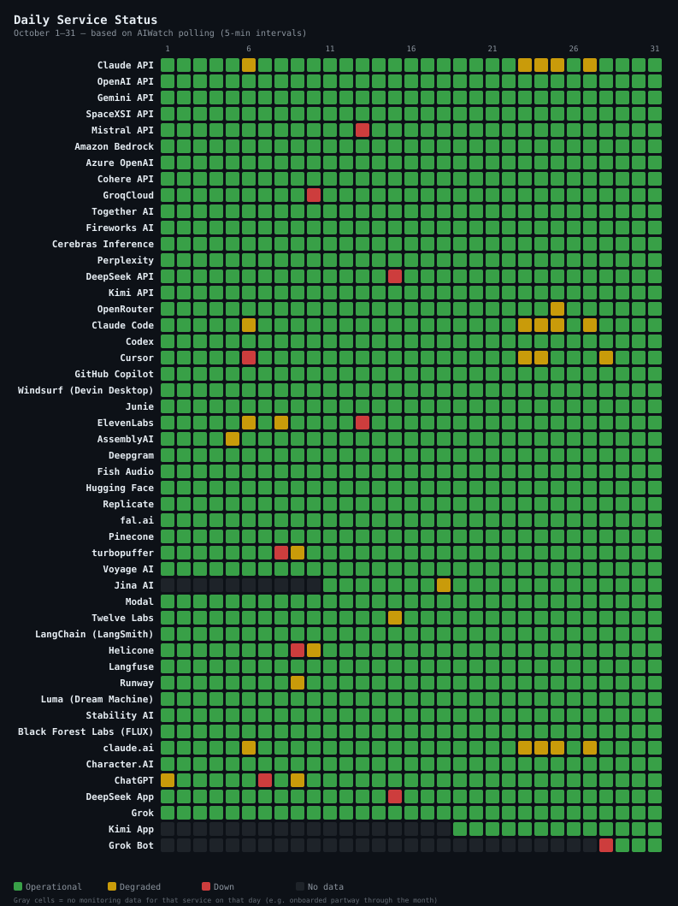
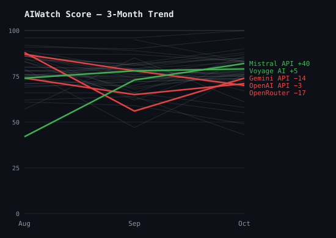
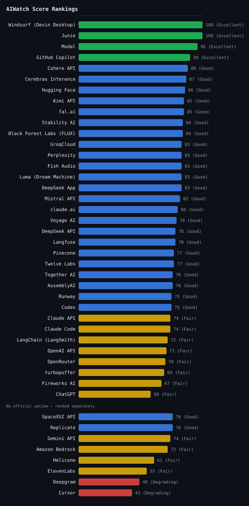

> **Source**: [ai-watch.dev](https://ai-watch.dev) — Real-time AI service status monitoring
> **Period**: October 1–31, 2026
> **Published**: November 2026
> **Services monitored**: 49 — 16 LLM APIs, 9 inference & infra, 7 AI apps, 6 coding agents, 4 voice & transcription, 3 observability, 2 video, 2 image

<!-- AUTHORING SELF-CHECK — read before writing prose; these are the recurring misses:
     1. CLAIMS BACKED BY DATA, AT THE RIGHT SCOPE. Every superlative/absolute ("the slowest", "the most",
        "worst month", "the only", "never") must be TRUE over the scope you state. Qualify to what the
        measurement supports: p75 is an edge-RTT probe to ONE endpoint, not "the slowest SERVICE"; a
        "worst month" must hold on the metric you mean (Score? downtime?) and beat EVERY peer — check the
        data, a lower-scoring sibling breaks "worst coding agent". Prefer "highest edge-probe RTT among
        probed services" / "most downtime of any coding agent" to a bare superlative. Soften unprovable
        absolutes ("never" -> "rarely").
     2. ONE HOME PER FACT — don't over-emphasise. A specific figure/superlative (e.g. one service's p75)
        belongs in ONE analytical home (its Notable Incident, or the data table), not restated across
        Summary + Notable Incidents + Observations. Weight a factor by its real contribution, not by how
        many times you can repeat it.
     3. ADVISORY != OUTAGE. Before calling something an outage, read the incident TITLE + impact, not just
        its duration. A usage-limits / billing / model-access / policy notice (often impact:minor) is an
        ADVISORY, not downtime — label it so (as the Anthropic entries do). If the archive counted such a
        notice as downtime it inflates the Score drop (a worker-side classification bug, cf. aiwatch#707);
        flag it. A long duration alone does not make an availability incident. -->

## Summary
<!-- BEGIN AUTO-DRAFT — review, then DELETE this entire block before merge -->
_Auto-generated narrative draft — English only; translate for the KO `
` block below._

- **Most reliable**: Windsurf (Devin Desktop), Junie (100 — zero incidents, perfect uptime)
- **Riskiest this month**: ChatGPT (58)
- **Most incidents**: Jina AI (81 incidents, 10h 10m downtime)

**Recommendations**
- **Primary**: Windsurf (Devin Desktop) or Junie
- **Fallback**: GitHub Copilot (1h 29m avg resolution) or Cohere API

**Recovery performance**: Fastest — Kimi App (3m avg). Slowest — OpenRouter (9h 31m avg).

> _Ranking language above excludes Gemini API, Amazon Bedrock, SpaceXSI API, ElevenLabs, Deepgram, Replicate, Helicone, Cursor — no official uptime, so their Score is not on the same scale and they are ranked in their own table (aiwatch-reports#106). Services excluded from the ranking entirely are named in the note above the Score table. Name any of them by hand if the month warrants it._

<!-- END AUTO-DRAFT -->

> Every score in this report is the **AIWatch Score** (0–100): one number combining uptime, incident load, recovery speed and responsiveness. Higher is better. [How it's built →](#aiwatch-score--october-2026-reliability-rankings)

- **Most reliable**:
- **Riskiest this month**:
- **High incident count, fast recovery**:
- **Watch out**:

<strong>Summary in Korean</strong>

<ul>
<li><strong>가장 안정적</strong>: </li>
<li><strong>이번 달 가장 위험</strong>: </li>
<li><strong>잦은 장애, 빠른 복구</strong>: </li>
<li><strong>주의 필요</strong>: </li>
</ul>

---

## Recommendations

<table class="recommendations">
<thead>
<tr><th>Use Case</th><th>Recommended</th><th>Why</th></tr>
</thead>
<tbody>
<tr><td><strong>Production-critical</strong></td><td><em>(service)</em></td><td><em>(why)</em></td></tr>
<tr><td><strong>Low latency / cost</strong></td><td><em>(service)</em></td><td><em>(why)</em></td></tr>
<tr><td><strong>Coding Agents</strong></td><td><em>(service)</em></td><td><em>(why)</em></td></tr>
<tr><td><strong>Voice / audio</strong></td><td><em>(service)</em></td><td><em>(why)</em></td></tr>
<!-- General purpose: pick among the major first-party LLM APIs (OpenAI API, Claude API, Gemini API,
     Mistral API), not open-model inference platforms or routers (Fireworks AI, Together AI, Groq Cloud,
     OpenRouter). If none of them reaches Good, pick the best of them and say so in Why rather than
     reaching outside the set. -->
<tr><td><strong>General purpose</strong></td><td><em>(service)</em></td><td><em>(why)</em></td></tr>
</tbody>
</table>

---

## Key Insight

October 2026 showed a clear divide: Windsurf (Devin Desktop), Junie, and Modal remained highly stable, while ChatGPT (58) experienced the most challenges. 34 out of 49 services recorded at least one incident, with a combined downtime of 653h 30m.

- **Pattern 1**:
- **Pattern 2**:
- **Pattern 3**:

<strong>Key Insight in Korean</strong>

<!-- Opening narrative in Korean -->

<ul>
<li><strong>패턴 1</strong>: </li>
<li><strong>패턴 2</strong>: </li>
<li><strong>패턴 3</strong>: </li>
</ul>

---

## 3-Month Trend

AIWatch Score direction over the last 3 months (2026-08 → 2026-10). The lines plot each service's composite Score. **Notable Movers** below are NOT ranked by these lines — a service earns its place, and its order, by the largest change on *any* of three axes (Score, recovery time, or total downtime), which is why one with a small Score move can top the list on a downtime swing the chart cannot show.

### Notable Movers

*The 5 services whose **Score, recovery time (MTTR), or total downtime** changed most over the window (ranked by the largest single change, not a fixed threshold). The metric in **bold** is the change that ranked each service here; 🔺 / 🔻 mark whether that headline metric improved or worsened — so a service can show a small Score gain yet land here, and read 🔻, because its downtime regressed.*

- 🔺 **Gemini API** — Score 88 → 56 → 74 (−14) · **MTTR — → 45h 11m → 2h 49m (−42h 22m)** · downtime — → 45h 11m → 2h 49m (−42h 22m)
- 🔺 **OpenAI API** — Score 74 → 65 → 71 (−3) · **MTTR 14h 33m → 2h 51m → 2h 10m (−12h 23m)** · downtime 29h 5m → 19h 55m → 21h 40m (−7h 25m)
- 🔺 **Voyage AI** — Score 74 → 78 → 79 (+5) · **MTTR 11h 20m → 22m → 34m (−10h 46m)** · downtime 11h 20m → 1h 26m → 34m (−10h 46m)
- 🔻 **OpenRouter** — Score 87 → 78 → 70 (−17) · **MTTR 1h 22m → 1h 37m → 9h 31m (+8h 9m)** · downtime 2h 44m → 4h 50m → 47h 37m (+44h 53m)
- 🔺 **Mistral API** — Score 42 → 73 → 82 (+40) · MTTR 6h 50m → 41m → 1h 34m (−5h 16m) · **downtime 129h 50m → 24h 49m → 3h 7m (−126h 43m)**

> **Downtime counting changed in September 2026**: from then on, time when several incidents were open at once counts once, and incidents opened by a provider's automatic monitor count as downtime. MTTR and downtime for the earlier months above are recounted from those months' incident records under the new rule, so they can differ from the figures in those months' own reports.

---

## AIWatch Score — October 2026 Reliability Rankings

**AIWatch Score (0–100)** is designed to answer one question:

> *"Which AI service is safest to rely on in production?"*

Combines four components — Uptime (40%), Incident affected days (25%), Recovery speed (15%), Responsiveness (20%, the p50 RTT + stability figures shown under [Responsiveness Inputs](#responsiveness-inputs-score-component)). The separate [API Response Time — Monthly p75](#api-response-time--monthly-p75) table is a network-latency reference that does *not* feed the Score; full breakdown of weights, fallbacks, and penalties is in [About This Report → AIWatch Score](#about-this-report). [How it's calculated →](https://ai-watch.dev/methodology#score)

*43 of 49 services ranked — 35 in the table below, 8 with no official uptime ranked separately under it. **Azure OpenAI, Grok, Grok Bot are excluded from this ranking** — no official uptime metric and no direct latency probe, so AIWatch can measure only two of the Score's four components and withholds a Score rather than rank on insufficient signal. Incidents are still tracked (see [Incident Summary](#incident-summary)). **Character.AI is excluded from this ranking** — its incident feed is frozen, so the Score would rest on a partial month (see "Stale source" under [Incident Summary](#incident-summary)). **Jina AI and Kimi App are excluded from this ranking** — they were added to AIWatch mid-month, so the partial-month Score rests on insufficient coverage; they rejoin once a full month of data accrues.*

| Rank | Service | Score | Grade | Uptime Source | Why |
|---|---|---|---|---|---|
| 1= | Windsurf (Devin Desktop) | 100 | Excellent | Official | Zero incidents, 100.00% uptime |
| 1= | Junie | 100 | Excellent | Official | Zero incidents, 100.00% uptime |
| 3 | Modal | 96 | Excellent | Platform | 6 incidents, fast recovery (avg 12m over 4) |
| 4 | GitHub Copilot | 90 | Excellent | Official | 3 incidents, avg 1h 29m |
| 5 | Cohere API | 88 | Good | Official | Zero incidents, 100.00% uptime — lost 12 pts on Responsiveness (latency) |
| 6 | Cerebras Inference | 87 | Good | Official | Zero incidents, 100.00% uptime — lost 13 pts on Responsiveness (latency) |
| 7 | Hugging Face | 86 | Good | Platform | Zero incidents, 100.00% uptime — lost 14 pts on Responsiveness (latency) |
| 8= | Kimi API | 85 | Good | Official | Zero incidents, 99.98% uptime — lost <1 pt on Uptime, 15 pts on Responsiveness (latency) |
| 8= | fal.ai | 85 | Good | Official | Zero incidents, 100.00% uptime — lost 15 pts on Responsiveness (latency) |
| 10= | Stability AI | 84 | Good | Official | Zero incidents, 100.00% uptime — lost 16 pts on Responsiveness (latency) |
| 10= | Black Forest Labs (FLUX) | 84 | Good | Official | Zero incidents, 100.00% uptime — lost 16 pts on Responsiveness (latency) |
| 12= | GroqCloud | 83 | Good | Official | 3 incidents, avg 2h 16m |
| 12= | Perplexity | 83 | Good | Official | 1 incident, 37m |
| 12= | Fish Audio | 83 | Good | Platform | 3 incidents |
| 12= | Luma (Dream Machine) | 83 | Good | Platform | Zero incidents, 100.00% uptime — lost 17 pts on Responsiveness (latency) |
| 12= | DeepSeek App | 83 | Good | Official | 6 incidents, avg 1h 15m |
| 17 | Mistral API | 82 | Good | Official | 3 incidents, avg 1h 34m over 2 |
| 18 | claude.ai | 80 | Good | Official | 13 incidents, avg 1h 14m |
| 19 | Voyage AI | 79 | Good | Official | 1 incident, 34m |
| 20= | DeepSeek API | 78 | Good | Official | 5 incidents, avg 1h 29m |
| 20= | Langfuse | 78 | Good | Official | 4 incidents, avg 45m |
| 22= | Pinecone | 77 | Good | Official | 2 incidents, avg 1h 10m over 1 |
| 22= | Twelve Labs | 77 | Good | Official | 12 incidents, fast recovery (avg 13m) |
| 24= | Together AI | 76 | Good | Platform | 39 incidents |
| 24= | AssemblyAI | 76 | Good | Official | 5 incidents, avg 42m over 4 |
| 26= | Runway | 75 | Good | Official | 5 incidents, avg 1h 44m over 4 |
| 26= | Codex | 75 | Good | Official | 7 incidents, avg 3h 32m over 6 |
| 28= | Claude API | 74 | Fair | Official | 12 incidents, avg 1h 2m |
| 28= | Claude Code | 74 | Fair | Official | 12 incidents, avg 59m |
| 30 | LangChain (LangSmith) | 72 | Fair | Official | 7 incidents, avg 1h 59m over 5 |
| 31 | OpenAI API | 71 | Fair | Official | 13 incidents, avg 2h 10m over 10 |
| 32 | OpenRouter | 70 | Fair | Official | 5 incidents, avg 9h 31m |
| 33 | turbopuffer | 69 | Fair | Official | 1 incident, 7h 27m |
| 34 | Fireworks AI | 67 | Fair | Official | 69 incidents, avg 39m over 66 |
| 35 | ChatGPT | 58 | Fair | Official | 28 incidents, avg 3h 7m over 21 |

**No Official Uptime**

*Scored on Incidents + Recovery + Responsiveness only — no official uptime metric, so these Scores are not on the same scale as a Score built from a measured uptime. Ranked separately rather than merged into one shared rank.*

| Rank | Service | Score | Grade | Why |
|---|---|---|---|---|
| 1= | SpaceXSI API | 76 | Good | Zero incidents — lost 24 pts on Responsiveness (latency) |
| 1= | Replicate | 76 | Good | Zero incidents — lost 24 pts on Responsiveness (latency) |
| 3 | Gemini API | 74 | Fair | 1 incident, 2h 49m |
| 4 | Amazon Bedrock | 72 | Fair | Zero incidents — lost 28 pts on Responsiveness (latency) |
| 5 | Helicone | 61 | Fair | 16 incidents |
| 6 | ElevenLabs | 55 | Fair | 18 incidents, avg 2h 18m over 9 |
| 7 | Deepgram | 49 | Degrading | 9 incidents, avg 3h 25m over 8 |
| 8 | Cursor | 43 | Degrading | 24 incidents, avg 1h 56m over 21 |

**Grade scale**: Excellent (90+) · Good (75+) · Fair (55+) · Degrading (40+) · Unstable (<40)

<!-- Generate with: node scripts/generate-charts.js 2026-10/index.md -->

> **Uptime Source column**: Official · Platform · No uptime. Platform figures are not on the same basis as Official — see [About This Report → Uptime Source](#about-this-report).
> <!-- Keep this caption short — full definitions live in the About This Report methodology section to avoid duplicating them here. -->

---

## 30-Day Uptime

Uptime computed by AIWatch — never a copy of the percentage a provider displays on its own page (those use different periods and different definitions of downtime). The exact method differs by source; see [About This Report → Uptime Source](#about-this-report) for what Official vs Platform means. A service can read 100.00% here and still show an incident in the Incident Summary — for example when the incident sat on a component outside this figure's scope, or the status page never marked any component degraded or down while it was open. See [About This Report → Uptime Metrics](#about-this-report). Full method: [ai-watch.dev/methodology](https://ai-watch.dev/methodology#uptime). The narrative-driven sections below (Incident Summary / Notable Incidents / Observations) cover what these numbers mean for vendor selection.

<table class="uptime-cols">
<thead><tr><th>Service</th><th>Uptime</th></tr></thead>
<tbody>
<tr><td>Cohere API</td><td>100.00%</td></tr>
<tr><td>Cerebras Inference</td><td>100.00%</td></tr>
<tr><td>Hugging Face</td><td>100.00%</td></tr>
<tr><td>fal.ai</td><td>100.00%</td></tr>
<tr><td>Stability AI</td><td>100.00%</td></tr>
<tr><td>Black Forest Labs (FLUX)</td><td>100.00%</td></tr>
<tr><td>Luma (Dream Machine)</td><td>100.00%</td></tr>
<tr><td>GitHub Copilot</td><td>100.00%</td></tr>
<tr><td>Windsurf (Devin Desktop)</td><td>100.00%</td></tr>
<tr><td>Junie</td><td>100.00%</td></tr>
<tr><td>GroqCloud</td><td>99.98%</td></tr>
<tr><td>Kimi API</td><td>99.98%</td></tr>
<tr><td>Modal</td><td>99.98%</td></tr>
<tr><td>Twelve Labs</td><td>99.98%</td></tr>
<tr><td>Runway</td><td>99.98%</td></tr>
<tr><td>Kimi App</td><td>99.98%</td></tr>
<tr><td>Perplexity</td><td>99.97%</td></tr>
<tr><td>AssemblyAI</td><td>99.97%</td></tr>
<tr><td>Fish Audio</td><td>99.97%</td></tr>
<tr><td>Voyage AI</td><td>99.97%</td></tr>
<tr><td>Mistral API</td><td>99.96%</td></tr>
<tr><td>Pinecone</td><td>99.96%</td></tr>
<tr><td>Langfuse</td><td>99.94%</td></tr>
<tr><td>Claude API</td><td>99.85%</td></tr>
<tr><td>Together AI</td><td>99.85%</td></tr>
<tr><td>claude.ai</td><td>99.84%</td></tr>
<tr><td>Claude Code</td><td>99.84%</td></tr>
<tr><td>OpenRouter</td><td>99.82%</td></tr>
<tr><td>DeepSeek API</td><td>99.78%</td></tr>
<tr><td>LangChain (LangSmith)</td><td>99.78%</td></tr>
<tr><td>turbopuffer</td><td>99.68%</td></tr>
<tr><td>Jina AI</td><td>99.66%</td></tr>
<tr><td>Codex</td><td>99.59%</td></tr>
<tr><td>DeepSeek App</td><td>99.39%</td></tr>
<tr><td>Fireworks AI</td><td>99.26%</td></tr>
<tr><td>OpenAI API</td><td>99.04%</td></tr>
<tr><td>ChatGPT</td><td>98.33%</td></tr>
</tbody>
</table>

*Amazon Bedrock, Azure OpenAI, Character.AI, Cursor, Deepgram, ElevenLabs, Gemini API, Grok, Grok Bot, Helicone, Replicate, and SpaceXSI API do not publish a comparable uptime percentage on their status pages — they're excluded from this table for that reason. (SpaceXSI API's [status page](https://status.x.ai) does expose per-endpoint live success rates measured since its monitoring system's last restart, but those numbers are not directly comparable to the figures above.)*

---

## Component Reliability

> AIWatch surfaces a **per-component uptime breakdown** — each multi-surface service's weakest component over the days AIWatch could read its status page, the surface most likely to be your bottleneck that a single service-level uptime number hides. It is a different measurement from the 30-Day Uptime table and **is not a Score input**; see [About This Report → Component Reliability](#about-this-report).

| Service | Weakest Component | Uptime | Components |
|---|---|---|---|
| LangChain (LangSmith) | LangSmith Sandboxes | 83.82% | 10 |
| ChatGPT | Codex in ChatGPT Desktop | 91.11% | 15 |
| Cursor | Cloud Agents | 95.93% | 8 |
| claude.ai | Claude Cowork | 98.23% | 2 |
| Fireworks AI | Kimi K3 | 98.91% | 22 |
| OpenAI API | Images | 99.01% | 14 |
| Deepgram | DG Whisper Cloud | 99.22% | 7 |
| AssemblyAI | Asynchronous API | 99.54% | 3 |
| Twelve Labs | Search Knowledge Store API | 99.64% | 20 |
| GroqCloud | minimaxai/minimax-m2.7 | 99.69% | 21 |
| Langfuse | Public API | 99.81% | 3 |
| Pinecone | Index Management | 99.84% | 5 |
| Runway | App | 99.85% | 3 |
| ElevenLabs | All features | 99.86% | 8 |
| GitHub Copilot | Copilot AI Model Providers | 99.87% | 2 |

---

## Responsiveness Inputs (Score Component)

> **This table feeds the Score.** These are the two figures the **Responsiveness** component (20% of
> the AIWatch Score) was computed from this month: each service's median (p50) probe RTT, and the
> combined coefficient of variation (CV) of that RTT — day-to-day movement plus the p95/p50 spread.
> **Lower is better for both**: a fast service still scores poorly here if it is erratic.
>
> Do not confuse it with [API Response Time — Monthly p75](#api-response-time--monthly-p75) further
> down. That table probes the **same endpoints** but its p75 figure is **not part of the Score** —
> it is a network-speed reference only. This one is scored; that one is not.
> [How each figure becomes a sub-score →](https://ai-watch.dev/methodology#score)

| Service | p50 RTT | RTT variation (CV) |
|---|---|---|
| Gemini API | 82 ms | 0.75 |
| Claude API | 162 ms | 0.58 |
| Claude Code | 162 ms | 0.58 |
| Codex | 185 ms | 0.65 |
| OpenAI API | 185 ms | 0.65 |
| Mistral API | 193 ms | 0.66 |
| Fireworks AI | 244 ms | 0.75 |
| GroqCloud | 247 ms | 0.66 |
| Cohere API | 251 ms | 0.69 |
| Together AI | 312 ms | 0.67 |
| Cerebras Inference | 344 ms | 0.70 |
| Perplexity | 385 ms | 0.79 |
| Hugging Face | 419 ms | 0.72 |
| Replicate | 430 ms | 0.81 |
| OpenRouter | 501 ms | 0.70 |
| ElevenLabs | 513 ms | 0.68 |
| SpaceXSI API | 516 ms | 0.65 |
| fal.ai | 575 ms | 0.65 |
| Kimi API | 666 ms | 0.53 |
| DeepSeek API | 692 ms | 0.45 |
| Stability AI | 704 ms | 0.71 |
| Fish Audio | 848 ms | 0.58 |
| AssemblyAI | 961 ms | 0.55 |
| Black Forest Labs (FLUX) | 988 ms | 0.57 |
| Voyage AI | 991 ms | 0.64 |
| Pinecone | 1008 ms | 0.54 |
| LangChain (LangSmith) | 1136 ms | 0.51 |
| Twelve Labs | 1239 ms | 0.50 |
| Runway | 1303 ms | 0.56 |
| turbopuffer | 1441 ms | 0.52 |
| Luma (Dream Machine) | 1460 ms | 0.59 |
| Helicone | 1535 ms | 0.50 |
| Cursor | 1586 ms | 0.58 |
| Langfuse | 1636 ms | 0.52 |
| Amazon Bedrock | 1708 ms | 0.57 |
| Deepgram | 1834 ms | 0.73 |

---

## API Response Time — Monthly p75

These p75 figures are a network-latency reference: direct API-endpoint round-trip time, probed from the Cloudflare Workers edge every 5 minutes — not inference latency. A probe that timed out measured no round trip and is left out of these figures; from October 2026, so is a probe answered with a server error (HTTP 5xx). Lower is better. **This table does not feed the Score** — the Score's Responsiveness component reads the *median* (p50) RTT and its stability instead, shown above under [Responsiveness Inputs](#responsiveness-inputs-score-component). So this table ranks *which service is fastest on the network*, while [AIWatch Score](#aiwatch-score--october-2026-reliability-rankings) ranks *which is safest to rely on*. A service AIWatch does not probe has no row here; that alone does not drop it from the Score ranking.

<!-- Data source: curl https://api.ai-watch.dev/api/probe/history?days=30 -->
<!-- One row per service with an archived avgLatencyMs (the probe set is on /methodology). A service AIWatch does not probe simply has no row here; that alone does not affect its Score. -->
<!-- p95 + Spikes are present in probe:daily:{date} (CLAUDE.md KV schema) but not yet
     surfaced by /api/report. vs-Last-Month additionally requires reading the previous
     month's archive:monthly:* and computing deltas. Re-add the columns once the
     report API carries them — file a tracking issue if not already open. -->

| Rank | Service | p75 (ms) |
|---|---|---|
| 1 | Gemini API | 106 |
| 2 | Claude API | 206 |
| 3 | OpenAI API | 235 |
| 4 | Mistral API | 249 |
| 5 | GroqCloud | 320 |
| 6 | Fireworks AI | 322 |
| 7 | Cohere API | 324 |
| 8 | Together AI | 394 |
| 9 | Cerebras Inference | 455 |
| 10 | Perplexity | 529 |
| 11 | Hugging Face | 547 |
| 12 | Replicate | 585 |
| 13 | OpenRouter | 645 |
| 14= | SpaceXSI API | 667 |
| 14= | ElevenLabs | 667 |
| 16 | fal.ai | 748 |
| 17 | Kimi API | 804 |
| 18 | DeepSeek API | 816 |
| 19 | Stability AI | 931 |
| 20 | Fish Audio | 1063 |
| 21 | Jina AI | 1123 |
| 22 | AssemblyAI | 1214 |
| 23 | Pinecone | 1240 |
| 24 | Black Forest Labs (FLUX) | 1249 |
| 25 | Voyage AI | 1292 |
| 26 | LangChain (LangSmith) | 1393 |
| 27 | Twelve Labs | 1542 |
| 28 | Runway | 1652 |
| 29 | turbopuffer | 1799 |
| 30 | Character.AI | 1876 |
| 31 | Luma (Dream Machine) | 1881 |
| 32 | Helicone | 1971 |
| 33 | Cursor | 2015 |
| 34 | Langfuse | 2049 |
| 35 | Amazon Bedrock | 2204 |
| 36 | Deepgram | 2412 |

---

## Detection & RTT Degradation

### RTT Degradation Detection

AIWatch's direct RTT probes flagged **145** RTT degradations this month, of which **107** were **not reflected on the providers' official status pages at the time of detection**.

| Service | RTT Degradations | Not on Status Page |
|---|---|---|
| Deepgram | 73 | 72 |
| Helicone | 35 | 0 |
| Perplexity | 12 | 12 |
| Gemini API | 6 | 6 |
| Hugging Face | 5 | 5 |
| Langfuse | 2 | 2 |
| Runway | 2 | 2 |
| Amazon Bedrock | 2 | 2 |
| Luma (Dream Machine) | 2 | 2 |
| Character.AI | 2 | 0 |
| ElevenLabs | 1 | 1 |
| Jina AI | 1 | 1 |
| Cursor | 1 | 1 |
| Fireworks AI | 1 | 1 |

> A detection is a signal, not a confirmed outage — what is counted: [How AIWatch Works → Detection](https://ai-watch.dev/methodology#detection).

---

## AI Prediction Accuracy

When an incident opens, AIWatch's AI publishes an estimated recovery window. **117** of those estimates could be scored against the incident's actual recovery in October. Median absolute error: **48m**.

| Metric | Value |
|---|---|
| Estimates scored | 117 |
| Median absolute error | 48m |
| Recovered within ½× to 1× the estimate | 29 (25%) |
| Recovered in under half the estimate | 55 (47%) |
| Took longer than the estimate | 33 (28%) |

> **How this is scored**: the estimate is the upper bound of the recovery window AIWatch published for that incident, and the error is the gap between that bound and the actual recovery. The three outcome rows add up to the estimates scored. One provider incident affecting several services is scored once. Not every incident carries an estimate, so this is a sample of the month's incidents — it is not comparable to the incident counts elsewhere in this report.

**Against past recovery times.** Would a simpler rule have done as well? For **90** of these incidents the service had enough earlier recorded incidents to estimate from how long they took. The same incidents, scored against each estimate:

| Estimate | Within ½× to 1× | Under ½× | Took longer | Median absolute error |
|---|---|---|---|---|
| AIWatch AI estimate | 18 | 44 | 28 | 54m |
| Past median recovery | 28 | 20 | 42 | 30m |
| Past 80th-percentile recovery | 10 | 62 | 18 | 1h 20m |

Recovered within ½× to 1× the estimate: **18** of 90 for the AI estimate, 28 for the past median, 10 for the past 80th percentile. Took longer than the estimate: 28, 42 and 18.

> The AI estimate is made after an incident opens, sometimes hours in; the past-recovery figures use only incidents that had ended before it started. That difference is not adjusted for.

---

<!-- BEGIN AUTO-DRAFT (Status Source Changes) — hand-filled from write-monthly-report step 1.5. Fill it and delete both fences, or delete this whole block (heading and rule included) when no status source changed this month. -->
## Status Source Changes

<!-- Name each provider-side move (from → to), checked against the service's own pre-move config, not the issue title, and any switch AIWatch made to the page it reads for a service. For each move that changed a figure in this report — lost official uptime, a different ranking table, a gap in incident coverage — say what changed and link that table. A Score that changed scale gets its component breakdown. -->

---
<!-- END AUTO-DRAFT (Status Source Changes) -->

## Incident Summary

> **Reading the count column**: The count is how many incidents a provider published for that service. Granularity differs — Anthropic posts a separate incident per model ("Elevated errors for Claude Opus 4.7"), and Together AI's status page tracks each model as its own component — so both show higher totals than providers that post one incident per event. Higher count ≠ lower reliability; adjust for granularity before comparing across providers. A Platform-source service can also carry **reconstructed** entries, counted one per (component, downtime day) instead of one per event. They count toward Inc and Downtime, but carry no recovery time, so they are left out of the Longest and Avg Resolution columns. A month mixing the two is not continuous with earlier months. Entries that overlap in time form one impact window, and Longest is the longest window. Where Avg Resolution reads "… over N", the average is taken over N impact windows, not over every entry. Full rules: [How AIWatch Works → Incident counting](https://ai-watch.dev/methodology#incidents).
>
> **Longest and Avg Resolution read "—" for Helicone, Together AI, Fish Audio.** Every entry for these services this month is reconstructed, so none carries a recovery time.
>
> <!-- Cycle-specific data notes (excluded incidents, anomalies) go here. -->

<table>
<thead>
<tr><th>Service</th><th>Inc</th><th>Downtime (longest)</th><th class="hide-mobile">Longest</th><th class="hide-mobile">Avg Resolution</th></tr>
</thead>
<tbody>
<tr><td>Helicone</td><td>16</td><td>189h 4m</td><td class="hide-mobile">—</td><td class="hide-mobile">—</td></tr>
<tr><td>ChatGPT</td><td>28</td><td>65h 32m (19h 7m)</td><td class="hide-mobile">19h 7m</td><td class="hide-mobile">3h 7m over 21</td></tr>
<tr><td>OpenRouter</td><td>5</td><td>47h 37m (37h 54m)</td><td class="hide-mobile">37h 54m</td><td class="hide-mobile">9h 31m</td></tr>
<tr><td>Fireworks AI</td><td>69</td><td>43h 23m (5h 19m)</td><td class="hide-mobile">5h 19m</td><td class="hide-mobile">39m over 66</td></tr>
<tr><td>Cursor</td><td>24</td><td>40h 30m (9h 35m)</td><td class="hide-mobile">9h 35m</td><td class="hide-mobile">1h 56m over 21</td></tr>
<tr><td>Together AI</td><td>39</td><td>29h 6m</td><td class="hide-mobile">—</td><td class="hide-mobile">—</td></tr>
<tr><td>Deepgram</td><td>9</td><td>27h 18m (19h)</td><td class="hide-mobile">19h</td><td class="hide-mobile">3h 25m over 8</td></tr>
<tr><td>Grok Bot</td><td>19</td><td>25h 1m (5h 19m)</td><td class="hide-mobile">5h 19m</td><td class="hide-mobile">1h 23m over 18</td></tr>
<tr><td>OpenAI API</td><td>13</td><td>21h 40m (6h 33m)</td><td class="hide-mobile">6h 33m</td><td class="hide-mobile">2h 10m over 10</td></tr>
<tr><td>Codex</td><td>7</td><td>21h 12m (8h 27m)</td><td class="hide-mobile">8h 27m</td><td class="hide-mobile">3h 32m over 6</td></tr>
<tr><td>ElevenLabs</td><td>18</td><td>20h 40m (6h 52m)</td><td class="hide-mobile">6h 52m</td><td class="hide-mobile">2h 18m over 9</td></tr>
<tr><td>claude.ai</td><td>13</td><td>16h 4m (4h 17m)</td><td class="hide-mobile">4h 17m</td><td class="hide-mobile">1h 14m</td></tr>
<tr><td>Claude API</td><td>12</td><td>12h 28m (6h 16m)</td><td class="hide-mobile">6h 16m</td><td class="hide-mobile">1h 2m</td></tr>
<tr><td>Claude Code</td><td>12</td><td>11h 47m (3h 47m)</td><td class="hide-mobile">3h 47m</td><td class="hide-mobile">59m</td></tr>
<tr><td>Jina AI</td><td>81</td><td>10h 10m (1h 10m)</td><td class="hide-mobile">1h 10m</td><td class="hide-mobile">12m over 52</td></tr>
<tr><td>LangChain (LangSmith)</td><td>7</td><td>9h 57m (5h 4m)</td><td class="hide-mobile">5h 4m</td><td class="hide-mobile">1h 59m over 5</td></tr>
<tr><td>DeepSeek App</td><td>6</td><td>7h 29m (4h 53m)</td><td class="hide-mobile">4h 53m</td><td class="hide-mobile">1h 15m</td></tr>
<tr><td>turbopuffer</td><td>1</td><td>7h 27m (7h 27m)</td><td class="hide-mobile">7h 27m</td><td class="hide-mobile">7h 27m</td></tr>
<tr><td>DeepSeek API</td><td>5</td><td>7h 23m (4h 53m)</td><td class="hide-mobile">4h 53m</td><td class="hide-mobile">1h 29m</td></tr>
<tr><td>Runway</td><td>5</td><td>6h 54m (4h 15m)</td><td class="hide-mobile">4h 15m</td><td class="hide-mobile">1h 44m over 4</td></tr>
<tr><td>GroqCloud</td><td>3</td><td>6h 49m (6h 6m)</td><td class="hide-mobile">6h 6m</td><td class="hide-mobile">2h 16m</td></tr>
<tr><td>GitHub Copilot</td><td>3</td><td>4h 28m (2h 30m)</td><td class="hide-mobile">2h 30m</td><td class="hide-mobile">1h 29m</td></tr>
<tr><td>Mistral API</td><td>3</td><td>3h 7m (2h 45m)</td><td class="hide-mobile">2h 45m</td><td class="hide-mobile">1h 34m over 2</td></tr>
<tr><td>Langfuse</td><td>4</td><td>2h 58m (59m)</td><td class="hide-mobile">59m</td><td class="hide-mobile">45m</td></tr>
<tr><td>Gemini API</td><td>1</td><td>2h 49m (2h 49m)</td><td class="hide-mobile">2h 49m</td><td class="hide-mobile">2h 49m</td></tr>
<tr><td>AssemblyAI</td><td>5</td><td>2h 48m (1h 19m)</td><td class="hide-mobile">1h 19m</td><td class="hide-mobile">42m over 4</td></tr>
<tr><td>Twelve Labs</td><td>12</td><td>2h 41m (44m)</td><td class="hide-mobile">44m</td><td class="hide-mobile">13m</td></tr>
<tr><td>Fish Audio</td><td>3</td><td>1h 42m</td><td class="hide-mobile">—</td><td class="hide-mobile">—</td></tr>
<tr><td>Modal</td><td>6</td><td>1h 40m (34m)</td><td class="hide-mobile">34m</td><td class="hide-mobile">12m over 4</td></tr>
<tr><td>Pinecone</td><td>2</td><td>1h 10m (1h 10m)</td><td class="hide-mobile">1h 10m</td><td class="hide-mobile">1h 10m over 1</td></tr>
<tr><td>Grok</td><td>2</td><td>1h 10m (1h 4m)</td><td class="hide-mobile">1h 4m</td><td class="hide-mobile">35m</td></tr>
<tr><td>Perplexity</td><td>1</td><td>37m (37m)</td><td class="hide-mobile">37m</td><td class="hide-mobile">37m</td></tr>
<tr><td>Voyage AI</td><td>1</td><td>34m (34m)</td><td class="hide-mobile">34m</td><td class="hide-mobile">34m</td></tr>
<tr><td>Kimi App</td><td>6</td><td>15m (7m)</td><td class="hide-mobile">7m</td><td class="hide-mobile">3m</td></tr>
</tbody>
</table>

**Zero incidents (14 services):** Amazon Bedrock, Azure OpenAI, Cohere API, Cerebras Inference, SpaceXSI API, Kimi API, Hugging Face, Replicate, fal.ai, Stability AI, Black Forest Labs (FLUX), Luma (Dream Machine), Windsurf (Devin Desktop), Junie — confirmed via their status-page incident feeds.

**Stale source (1 service):** Character.AI — AIWatch can no longer read its incident feed, which is frozen at the last reachable fetch. The incident count covers only the window up to that cutoff, not the full month, so treat it as a floor rather than a verified picture. A frozen feed also removes the service from the Score ranking.

---

## Notable Incidents

<!-- BEGIN AUTO-DRAFT (Notable Incidents) — review, adapt into the entries below, then DELETE this entire block before merge -->
_Auto-generated retrospective draft (gemma) — review for accuracy, adapt, then delete this block._

### 1. Service degradation
**Affected**: Fireworks AI
**Duration**: ongoing

The service is currently experiencing ongoing degradation with the root cause identified but not yet fully remediated.

### 2. Delayed usage data and budget enforcement
**Affected**: OpenRouter
**Duration**: 1d 14h

Usage monitoring and budget enforcement mechanisms experienced delays for over a day.

### 3. Elevated 5xx Errors
**Affected**: Deepgram
**Duration**: 19h

A major spike in 5xx server errors impacted service availability for 19 hours.

### 4. new thread failed on the latest desktop app version
**Affected**: ChatGPT
**Duration**: 6h 22m

Users were unable to initiate new threads specifically when using the latest desktop application version.

### 5. DeepSeek 网页/API 部分中断（DeepSeek Web/API Partially Unavailable）
**Affected**: DeepSeek API
**Duration**: 4h 53m

Critical partial unavailability affected both the web interface and the API.

### 6. Elevated rate of 5xx in gcp-us-central1
**Affected**: turbopuffer gcp-us-central1
**Duration**: 7h 27m

A major increase in 5xx error rates was observed within the gcp-us-central1 region.

<!-- END AUTO-DRAFT (Notable Incidents) -->

<!-- Top 5-6 notable incidents — the report's main narrative content. Place this
     section in the narrative cluster (Incident Summary → Notable Incidents →
     Observations) that follows the metrics cluster (Score → 30-Day Uptime →
     API Response Time → Detection & RTT Degradation). Each entry: title with key duration,
     affected component(s), and a short prose paragraph that explains scope +
     remediation/mitigation.
     Each entry must describe the ACTUAL EVENT — pull the real title / root cause from the archive's
     incidentList (what broke, which component, the provider's own wording), NOT just "downtime was N
     hours". And verify it is a genuine availability incident (see AUTHORING SELF-CHECK #3): if the
     longest "incident" is a usage-limits / policy advisory, say so and do not frame it as an outage. -->

### 1. [Title]
**Affected**: <!-- Include region if applicable: e.g., "SpaceXSI API — EU (eu-west-1)" -->
**Duration**:

<!-- Description -->

---

## Observations

<!-- BEGIN AUTO-DRAFT (Observations) — review, adapt into the bullets below, then DELETE this entire block before merge -->
_Auto-generated retrospective draft (gemma) — review, adapt into prescriptive bullets, then delete this block._

- Prioritize Modal or Kimi App for production workloads requiring high availability and rapid recovery.
- Treat Cursor as a high-risk service for development workflows due to its degrading reliability score.
- Implement robust fallback logic for Deepgram and ChatGPT to mitigate long average recovery times.
- Monitor Fireworks AI closely and avoid using it for mission-critical tasks until the ongoing degradation is resolved.

<!-- END AUTO-DRAFT (Observations) -->

**This month's** per-service resilience deltas — what each service's data *newly* argues for. The evergreen, month-to-month-stable patterns (per-model monitoring, Voice-Agent isolation, key rotation, retry-timeout tuning, failover mechanics) live once in **[Resilience Patterns](../resilience/)** — link there, don't re-explain them. Each bullet ties THIS month's failure mode to the relevant pattern and adds only what's new.

<!-- ROLE BOUNDARY — this section vs its neighbours (they blur; keep each to its ONE job):
     • Recommendations   = the PICKS TABLE — WHO to use per use case. Only place for picks.
     • Notable Incidents = the EVENT — what happened + why it mattered. DESCRIBE; do not prescribe.
     • Incident Summary note = how to READ the counts (granularity; count ≠ reliability). Only home for that.
     • ../resilience/ (Resilience Patterns) = the EVERGREEN, structural how-to-build guidance that holds
       every month (per-model monitoring, Voice-Agent isolation, Gemini key rotation + dual monitoring,
       fail over on your own tolerance, not the average recovery, coding-agent auto-failover). Stated ONCE there — do NOT re-lecture
       it monthly; that cross-month repetition is exactly what this split fixes. New evergreen pattern? Add it
       to that page, not here — following the MAINTENANCE curation rules at the top of ../resilience/
       (evergreen + high-value only, one pattern per failure-mode, prune stale bullets on edit).
     • Observations (here) = THIS MONTH'S DELTA only — the specific failure mode the month surfaced, tied to
       the relevant Resilience pattern with a link. The only home for the month's actionable advice, so Notable
       Incidents stays descriptive (don't end an incident with "keep a fallback" — put the delta here + link).
     THE TEST for a bullet: would it read identically next month? If yes, it's evergreen — move it to
     ../resilience/ and link. Every bullet must carry a DATE-TIED fact (this month X's worst was a 27h Y; a
     single 72h Z) and point at the pattern, not restate the architecture. A partial-month / withheld-Score
     CAVEAT (e.g. Character.AI) is a legitimate month-specific bullet too. -->

- **[Service]**: <!-- THIS month's date-tied failure fact (e.g. "its worst incident was a 27h streaming-STT degradation; p75 the highest probed"), DEEP-linked to the relevant Resilience pattern ([Resilience → Deepgram](../resilience/#deepgram)). Do NOT re-explain the evergreen pattern — link it. -->
- **[Service]**: <!-- 2-4 bullets total; only services whose THIS-MONTH data yields a new lesson. If a service's story is unchanged from a prior report, omit it (the pattern already lives in ../resilience/). -->
<!-- A partial-month / withheld-Score CAVEAT bullet (e.g. Character.AI: why its Score is absent + how to read
     its half-month counts) belongs here too — it's month-specific and not an evergreen pattern. -->

---

## Security Alerts

> **Note:** Security alerts captured during the month from OSV.dev (AI SDK package vulnerabilities), Hacker News (security posts mentioning monitored services), and NVD (first-party product CVEs). Section omitted for months without detections.

**Total alerts:** 5

**By source**

| Source | Count |
|---|---|
| Hacker News | 2 |
| NVD | 2 |
| OSV.dev | 1 |
{: .numeric-table .label-first}

**By severity**

| Critical | High | Medium | Low |
| --- | --- | --- | --- |
| 0 | 3 | 0 | 0 |
{: .numeric-table}

**Most affected services**

- **Product**: a CVE in the service's own product (NVD)
- **SDK**: a CVE in an SDK/package you install (OSV)

| Service | Product | SDK | Total |
|---|---|---|---|
| Claude Code | 2 | 0 | 2 |
| Hugging Face | 0 | 1 | 1 |
{: .numeric-table .label-first}

### Top Findings

#### 1. [CVE-2026-86063: Claude Code is an agentic coding tool.](https://nvd.nist.gov/vuln/detail/CVE-2026-86063) · `high`
- **Source:** NVD
- **Affected:** Claude Code
- **Detected:** 2026-10-13

#### 2. [CVE-2026-103435: Claude Code validated that a target file path resided within the project working directory at permission-check time, but re-resolved the ...](https://nvd.nist.gov/vuln/detail/CVE-2026-103435) · `high`
- **Source:** NVD
- **Affected:** Claude Code
- **Detected:** 2026-10-07

#### 3. [Hugging Face Transformers downloads custom generation code before trust consent](https://nvd.nist.gov/vuln/detail/CVE-2026-80047) · `high`
- **Source:** OSV.dev
- **Affected:** Hugging Face
- **Detected:** 2026-10-01

#### 4. [Visual Studio Copilot and SSMS Remote Code Execution (CVE-2026-103572)](https://embracethered.com/blog/posts/2026/visual-studio-copilot-remote-code-execution/) · `unrated`
- **Source:** Hacker News
- **Detected:** 2026-10-14

#### 5. [From Select to Sysadmin: Hijacking Microsoft SQL Copilot (CVE-2026-65669)](https://embracethered.com/blog/posts/2026/from-select-to-sysadmin-sql-copilot-bluehat-asia/) · `unrated`
- **Source:** Hacker News
- **Detected:** 2026-10-01

---

## About This Report

* **Data Sources:** Real-time data is aggregated from official status pages via multiple frameworks, including Atlassian Statuspage, incident.io, Google Cloud Status, Better Stack, Instatus, OnlineOrNot, and RSS feeds (Source: [ai-watch.dev](https://ai-watch.dev)).
* **Monitoring Frequency:** All 49 services are polled every **5 minutes** via Cloudflare Workers. Those with a probeable API endpoint also get a direct response-time (RTT) health-check at the same interval.
* **AIWatch Score (0–100):** Calculated from four components — **Uptime** (40%), **Incident affected days** (25%), **Recovery speed** (15%), and **Responsiveness** (20%). A service with no probe endpoint is scored on the remaining components rescaled to 100, with **no penalty**. A service that has a probe but fewer than 7 days of samples gets that same rescale **plus a 5% penalty** until its probe data matures. Full methodology: [ai-watch.dev/methodology#score](https://ai-watch.dev/methodology#score)
* **Uptime Source:** *Official* = AIWatch computes an uptime figure from the incident and outage records the provider publishes on its status page. *Platform* = a different computation built from the status-page platform's own monitors (Better Stack) rather than incidents the provider declared. *No uptime* = no uptime figure resolved for this row — usually because the status page publishes none, occasionally a figure AIWatch computed but withheld; a service in this tier may still publish incident records, which is what drives the MTTR/downtime figures elsewhere in this report. The exact window and weighting behind each figure varies by status-page platform; full source-by-source method: [ai-watch.dev/methodology](https://ai-watch.dev/methodology#uptime). The Score then drops its 40-point Uptime component and is rescaled over the remaining signals (incidents, recovery, responsiveness), so the result is **not** on the same scale as a Score built from a measured uptime. Where this report knows which services those are, they are **ranked in their own table**, never merged into a single rank sequence. A service with **neither** uptime **nor** a probe has too little signal, so its Score is withheld and it is not ranked at all. The note above the Score table names whichever services that is — the membership is read from the data, not fixed here. A service AIWatch tracked for only part of the month is **excluded from the ranking** rather than labelled — its partial-month Score would rest on insufficient coverage. The label describes the Uptime input, not the Score's rigour.
* **Uptime Metrics:** Every percentage in the 30-Day Uptime table is computed by AIWatch from the outage records the status page publishes — never copied from the figure a provider displays on its own page, and computed by a different method depending on the Uptime Source (see *Uptime Source* above). Its **scope** depends on what the page exposes: a single component for some services, a worst-of across a component set for others, an upstream platform monitor for others still. A service with no resolved uptime figure (see *No uptime* under *Uptime Source* above) doesn't get a row in this table at all. A service's **Incident Summary** count and total downtime are not limited to that same scope, though — an incident on a component outside it still adds to those totals without moving the uptime percentage, which is why the two can diverge sharply for one long incident on a narrower surface. An incident can also add to those totals without moving the uptime percentage when the status page never marks any component degraded or down while it is open.
* **Component Reliability:** A **different measurement** from every other uptime figure in this report — do not compare them. AIWatch polls each service's status page every 5 minutes and, per component, counts a poll as good **only** when that component reads `operational`; `degraded` and `partial outage` both count against it, with no weighting by incident severity (severity is recorded per *service*, not per component). The percentage is that ratio of good polls, over the days AIWatch could read the page. Only components AIWatch surfaces for that service are counted — billing, docs and compliance surfaces are excluded — and a service needs at least two of them to appear at all. The table lists only each service's **weakest** component, and only when it fell below 99.9%: it is a list of where to look, not a ranking of everything.
* **Timezone Standard:** All timestamps are recorded in **UTC**.

**Next report**: November 2026

---

- **Live status** — [ai-watch.dev](https://ai-watch.dev)
- **Slack/Discord alerts** — [ai-watch.dev/#settings](https://ai-watch.dev/#settings)
- **Score methodology** — [ai-watch.dev/methodology#score](https://ai-watch.dev/methodology#score)
- **All reports** — [ai-watch.dev/reports](https://ai-watch.dev/reports/)

---

- *Have feedback or spotted an error?* [Open an issue](https://github.com/bentleypark/aiwatch/issues/new)
- *Want us to track a service?* [Request here](https://github.com/bentleypark/aiwatch/issues/new?template=service_request.md)
